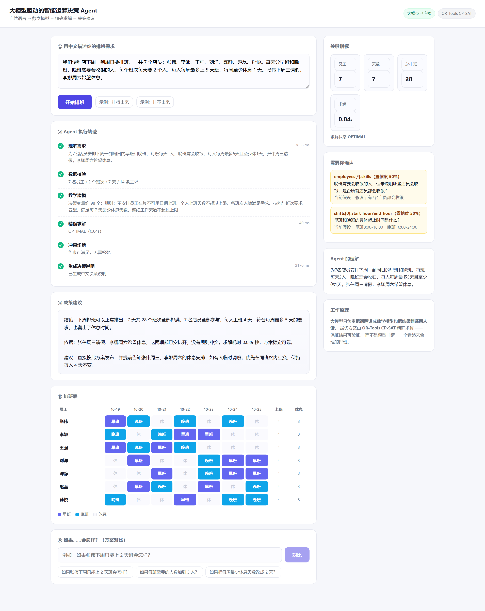
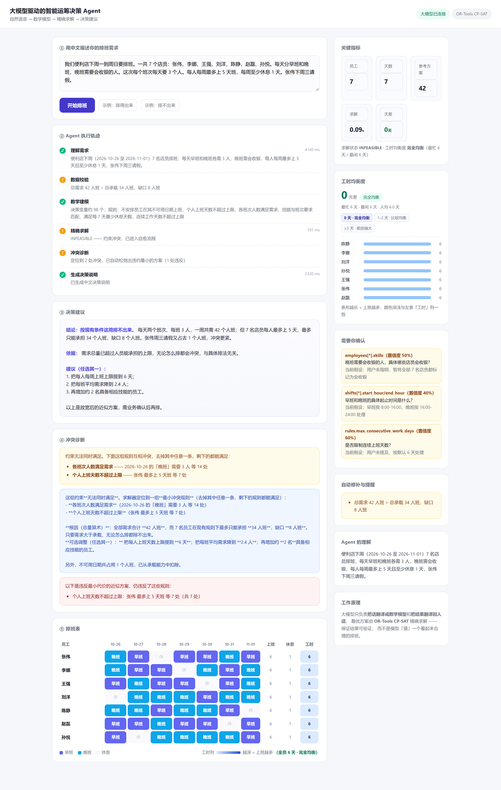
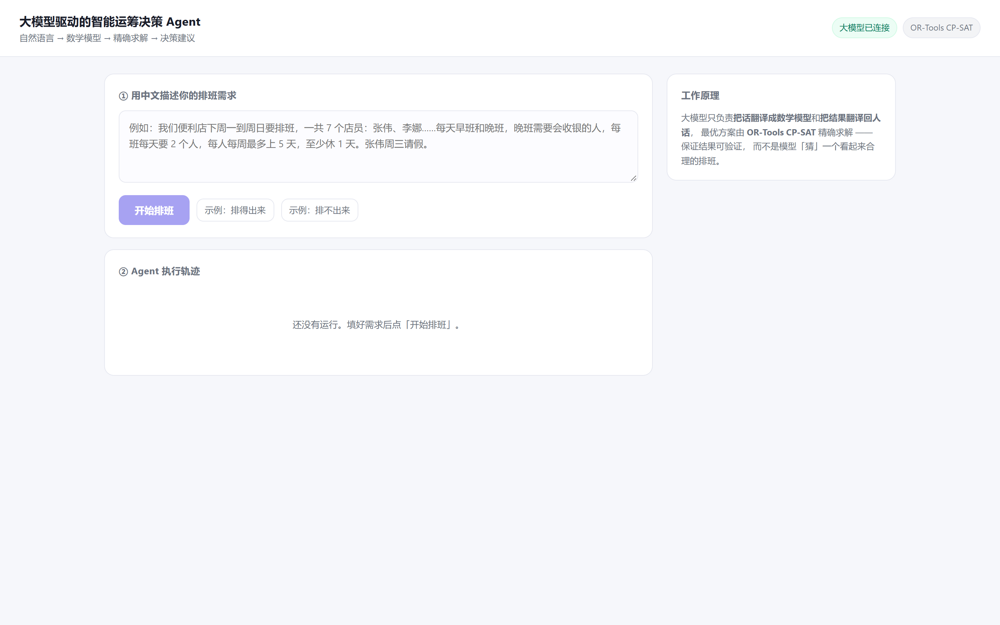
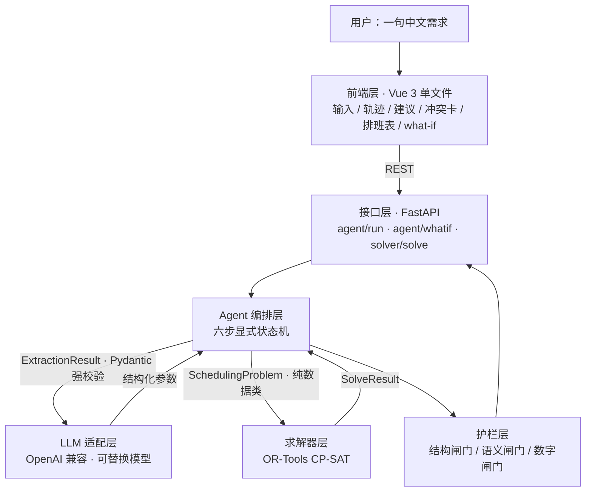

# 大模型驱动的智能运筹决策 Agent

> 传智杯 · AI WEB 网页开发挑战赛 参赛作品
>
> 用一句中文描述业务排班需求，Agent 自动完成**数学建模 → 精确求解 → 决策解释 → 冲突自愈**。

---

## 1. 它解决什么问题

排班是几乎每家企业都要做、却很少做好的事：店长拿 Excel 手工排，耗时几小时，还经常违反工时规定、漏掉员工请假、忙闲不均。

市面上的 AI 工具有两种极端：

| 做法 | 问题 |
| --- | --- |
| 纯大模型直接「排一个方案」 | 看起来合理，**但算不对**——会漏需求、超工时，无法验证 |
| 传统排班软件 | 能算对，**但要求用户会用建模语言**，业务人员上手困难 |

**本项目的做法：让大模型只做「翻译」，让求解器做「计算」。**

```
用户的中文需求
      │  ① 大模型：理解意图 → 结构化参数（JSON Schema 强约束）
      ▼
   数学模型（决策变量 / 目标函数 / 约束）
      │  ② OR-Tools CP-SAT：精确求解，保证最优性与可验证性
      ▼
   最优排班方案 + 冲突诊断（若不可行则自动定位冲突规则并给出松弛方案）
      │  ③ 大模型：把结果翻译成业务人员看得懂的决策建议
      ▼
   Web 界面：甘特式排班表 / 冲突卡片 / 关键指标
```

这就是所谓的**神经-符号混合（Neuro-Symbolic）**架构：大模型负责语义，求解器负责数学。**结果既好用，又算得对。**

---

## 2. 核心能力

- **自然语言建模** —— 「7 个店员，每天早班晚班各 2 人，每人每周最多 5 天，张伟周三请假」→ 直接出方案
- **精确最优解** —— 用 CP-SAT 求解，不是猜。同一输入永远同一输出，可复现
- **不可行自愈** —— 约束冲突时，用「假设字面量 + 删除法」定位**最小冲突规则集**，并给出可执行的调整建议（详见第 6 节）
- **what-if 方案对比** —— 「如果张伟下周只能上 2 天班会怎样」→ 解析成结构化变更 → 重解 → **最小扰动重排**，只改动必须改的几条，其余原封不动（见第 6.2 节）
- **数字护栏** —— 决策说明里的每个数字都必须能在后端算出的事实中找到，拦住大模型的「编数字」
- **人在环确认** —— 低置信度字段以确认卡形式提示用户，而不是直接塞进模型
- **离线可跑** —— 内置 Vue 3，无 CDN 依赖、无构建步骤；`LLM_MOCK=1` 时无需 API Key 即可体验界面

### 界面预览

**① 一句中文，出一个排班方案**（左：六步执行轨迹，每步耗时可见；右：关键指标 + 待确认项）



> 注意左侧轨迹的耗时分布：**「理解需求」3850 ms、「生成决策说明」2170 ms 是大模型在跑，中间的「精确求解」只有 40 ms**——真正的计算不在大模型里，这就是本项目的核心结构。

**② 无解时不报错，而是说清哪里冲突、并给出可行方案**



---

## 3. 快速开始

### 3.1 环境要求

| 依赖 | 版本 | 说明 |
| --- | --- | --- |
| Python | 3.10+（开发用 3.13.5） | 后端运行环境 |
| Git | 任意 | 版本管理 |
| 网络 | 能访问 DeepSeek API | 仅在非 mock 模式需要 |

> 前端**不需要 Node.js**：Vue 3 已内置在 `backend/app/static/vendor/`，打开页面即用。

### 3.2 安装

```powershell
# 1) 建虚拟环境（注意：把临时目录指到工作区内，避免沙箱/权限问题）
python -m venv .venv

# 2) 安装依赖（国内建议用清华镜像）
.\.venv\Scripts\python.exe -m pip install -r backend\requirements.txt `
    -i https://pypi.tuna.tsinghua.edu.cn/simple
```

### 3.3 配置 API Key

```powershell
Copy-Item backend\.env.example backend\.env
# 编辑 backend\.env，把 DEEPSEEK_API_KEY 换成你自己的（https://platform.deepseek.com/api_keys）
```

> `.env` 已在 `.gitignore` 中，**不会**被提交。仓库里只保留 `.env.example`。

### 3.4 启动

```powershell
cd backend
..\.venv\Scripts\python.exe -m uvicorn app.main:app --reload --port 8000
```

打开 **<http://127.0.0.1:8000>** 即可使用。API 文档在 <http://127.0.0.1:8000/docs>。

启动成功后应该看到这个页面（右上角两个徽标分别是「大模型已连接」和「OR-Tools CP-SAT」，说明 Key 和求解器都就绪）：



**没有 API Key？** 用离线样例模式：

```powershell
$env:LLM_MOCK="1"
..\.venv\Scripts\python.exe -m uvicorn app.main:app --reload --port 8000
```

**只想验证求解器（完全不联网）？**

```powershell
cd backend
..\.venv\Scripts\python.exe demo_scheduling.py
```

会依次输出「约束合理 → 最优排班」和「约束冲突 → 自动诊断 + 松弛方案」两个完整案例。

### 3.5 队友上手（克隆后必做的四步）

```powershell
git clone https://github.com/bjun3547-jpg/aiweb-decision-agent.git F:\AIWeb
cd F:\AIWeb
```

**① 设成你自己的名字**（不设的话，你的提交会挂在别人名下）

```powershell
git config user.name  "你的名字"
git config user.email "你的邮箱"
git log -1 --format="%an <%ae>"    # 确认生效
```

**② 修复 Git 的 TLS 后端**（Windows 上 git 默认用 schannel，某些机器会直接失败）

```powershell
git config http.sslBackend openssl
```

如果 `git push` 报 `Recv failure: Connection was reset` 或连接超时，说明需要走代理：

```powershell
git config http.proxy http://127.0.0.1:7897    # 换成你自己的代理端口
```

> 这两条是**仓库级配置**，存在 `.git/config` 里，不会跟着仓库同步。每台机器都要自己设一次。

**③ 建 Python 环境**

```powershell
python -m venv .venv
.\.venv\Scripts\python.exe -m pip install -r backend\requirements.txt -i https://pypi.tuna.tsinghua.edu.cn/simple
```

> 用清华镜像，官方源在国内会慢到超时。

**④ 配置并启动**

```powershell
Copy-Item backend\.env.example backend\.env
# 编辑 backend\.env，填入你自己的 DEEPSEEK_API_KEY 或队友共享的 Key

cd backend
..\.venv\Scripts\python.exe -m uvicorn app.main:app --reload --port 8000
```

打开 <http://127.0.0.1:8000>，点「示例：排得出来」→「开始排班」，能看到排班表就说明环境 OK。

> 没有 Key 也能验证界面：先设 `$env:LLM_MOCK="1"` 再启动，会返回内置样例数据。

### 3.6 三人协作规矩（很重要，不遵守会互相覆盖）

**分工到文件，不要两个人同时改同一个文件：**

| 角色 | 负责的目录 / 文件 | 尽量不要碰 |
| --- | --- | --- |
| 冯璐（队长） | `backend/app/agent.py`、`llm.py`、`prompts.py`、`main.py` | `solver/`、`static/` |
| 李芳青 | `backend/app/static/`（前端页面） | `solver/`、`agent.py` |
| 郑茜文 | `docs/`、`backend/app/solver/` | `static/`、`agent.py` |

**每天的标准动作（照做不会出事）：**

```powershell
cd F:\AIWeb
git pull                                  # ① 动手前先拉别人的改动
# ... 改代码 ...
git add .
git commit -m "feat: 做了什么"
git pull                                  # ② 推送前再拉一次
git push
```

**遇到 `! [rejected] main -> main (fetch first)` 怎么办？**

不要慌，这说明队友比你先推了。执行：

```powershell
git pull --rebase
git push
```

`--rebase` 会把你的提交"叠"在队友的改动之上，不会产生多余的合并记录。

**遇到 `CONFLICT`（冲突）怎么办？**

说明你和队友改了**同一个文件的同一行**。这时候：

1. **不要乱删乱改**，立刻在群里说一声
2. 打开冲突文件，找 `<<<<<<<`、`=======`、`>>>>>>>` 这几个标记
3. 两个人商量保留哪个版本，删掉标记
4. `git add .` → `git commit -m "fix: 解决冲突"` → `git push`

> 根本上避免冲突的办法就是上面的**文件分工**。各改各的文件，冲突概率接近零。

### 3.7 常见问题（照报错原文查）

按报错里的关键词找，不用从头读。

---

**① `python : 无法将"python"项识别为 cmdlet、函数、脚本文件或可运行程序的名称`**

Python 没装，或装了但没加进 PATH。

```powershell
# 先确认到底有没有
py --version
where.exe python
```

有 `py` 就用 `py -m venv .venv` 代替 `python -m venv .venv`。都没有就去 <https://www.python.org/downloads/> 装，**安装第一屏必须勾选 `Add python.exe to PATH`**。

---

**② `pip install` 卡在 `Collecting ortools` 不动，或报 `ReadTimeoutError`**

官方源在国内基本拉不动（ortools 包很大）。换清华镜像：

```powershell
.\.venv\Scripts\python.exe -m pip install -r backend\requirements.txt -i https://pypi.tuna.tsinghua.edu.cn/simple
```

还超时就加大超时时间：

```powershell
.\.venv\Scripts\python.exe -m pip install -r backend\requirements.txt `
    -i https://pypi.tuna.tsinghua.edu.cn/simple --timeout 120
```

---

**③ `ModuleNotFoundError: No module named 'app'`**

启动命令不在 `backend` 目录下执行。`app` 是相对路径的包名，必须先进目录：

```powershell
cd F:\AIWeb\backend          # ← 这一步不能漏
..\.venv\Scripts\python.exe -m uvicorn app.main:app --reload --port 8000
```

---

**④ `[Errno 10048] error while attempting to bind on address ('127.0.0.1', 8000)`**

8000 端口被占用（常见于上次的服务没关干净）。两个办法：

```powershell
# 办法一：换个端口
..\.venv\Scripts\python.exe -m uvicorn app.main:app --reload --port 8001

# 办法二：杀掉占用 8000 的进程
netstat -ano | findstr :8000
taskkill /PID <上面查到的PID> /F
```

---

**⑤ 页面能打开，但点「开始排班」报 `未配置 API Key。请在 backend/.env 里设置 DEEPSEEK_API_KEY，或设置 LLM_MOCK=1 使用离线样例数据。`**

`backend/.env` 不存在，或存在但 `DEEPSEEK_API_KEY=` 后面是空的。

```powershell
Test-Path backend\.env                                   # 应该是 True
Select-String "DEEPSEEK_API_KEY" backend\.env            # 看后面有没有值
```

没有就建：

```powershell
Copy-Item backend\.env.example backend\.env
notepad backend\.env
```

---

**⑥ `API Key 无效（HTTP 401）。请检查 backend/.env 里的 DEEPSEEK_API_KEY。`**

Key 本身有问题。按顺序排查：

1. `DEEPSEEK_API_KEY=` 后面**不能有空格和引号**，正确写法是 `DEEPSEEK_API_KEY=sk-xxxxx`
2. Key 是否已过期或被删除 → 去 <https://platform.deepseek.com/api_keys> 重新复制
3. 复制时有没有漏字符 → 整行重新粘一遍

> 这个报错也顺带说明**网络是通的**：能收到 DeepSeek 的 401 响应，就说明请求已经发出去了。

---

**⑦ `账户余额不足（HTTP 402）。`**

去 <https://platform.deepseek.com/top_up> 充值。**充 10 元足够跑完整个赛程。**

成本参考（10/19 实测）：一次完整排班链路 = 2 次模型调用。DeepSeek 的余额是**批量结算**的，连续跑 6 次余额没有可见变化，隔夜才扣——所以别用余额判断"是不是在花钱"。按隔夜结算的差额估算，**一次约 0.1 元量级**，10 元可以跑上百次；30 题评测集加反复重录视频完全够用。

> 想知道当前余额：启动服务后访问 <http://127.0.0.1:8000/api/health>，`llm.balance` 字段里有；或直接跑 `..\.venv\Scripts\python.exe check_key.py`。

---

**⑧ `git push` 报 `Recv failure: Connection was reset` 或长时间无响应**

GitHub 直连不通，需要走代理：

```powershell
git config http.proxy http://127.0.0.1:7897    # 端口换成你自己代理软件的
git config http.sslBackend openssl
git push
```

---

**⑨ 排班表里的中文变成乱码 / 方框**

浏览器编码问题，或文件被以错误编码保存。先按 `Ctrl + F5` 强制刷新；仍然乱码就检查编辑器是否把文件存成了 GBK —— 所有 `.py` / `.md` / `.html` 一律用 **UTF-8** 保存。

> 写 PowerShell 脚本时有个坑：`.ps1` 文件必须是 **UTF-8 with BOM**。无 BOM 的 UTF-8 在中文 Windows 上会被按 GBK 解析，中文字节错位后会"吃掉"后面的 `}` 和引号，报出一堆位置完全不对的语法错误。

---

**⑩ 运行 Agent 报 `ModuleNotFoundError`（`No module named 'app'` 或 `No module named 'ortools'`）**

这是两个不同的问题，很容易混在一起：

| 报错里缺的模块 | 真正原因 | 解决 |
| --- | --- | --- |
| `app` | 运行方式不对：`agent.py` 是**模块**不是脚本，`from app import prompts` 要求 `backend/` 在模块搜索路径里。直接 `python app/agent.py` 时 Python 只把 `backend/app/` 加进路径，它去找的是 `backend/app/app/prompts.py` | 见下方三种正确跑法 |
| `ortools` / `fastapi` | **用错了 Python**。系统的 `python`（尤其 Anaconda）不是项目虚拟环境，没装这两个包 | 一律用 `.venv\Scripts\python.exe` |

**最省事的办法：双击 `run_agent.cmd`**（在仓库根目录）。它自动切到 `backend`、自动用项目的 venv、自动加载 `.env`，不依赖你当前在哪个目录，也不依赖系统 `python`。

```powershell
F:\AIWeb\run_agent.cmd                                          # 内置示例
F:\AIWeb\run_agent.cmd "我们店 5 个人，下周每天需要 2 个人上班"   # 自定义需求
```

想在终端里手动跑，四种方式都可以：

```powershell
cd F:\AIWeb\backend

# ① 模块方式（最标准）
..\.venv\Scripts\python.exe -m app.agent

# ② 直接跑文件（已做兼容，从仓库根目录也行）
..\.venv\Scripts\python.exe app\agent.py

# ③ 跑完整接口冒烟测试（推荐，覆盖 5 个接口）
..\.venv\Scripts\python.exe smoke_test.py --real

# ④ 单独自检 LLM 适配层（查 .env / Key / 网络 / schema 校验）
..\.venv\Scripts\python.exe app\llm.py
```

> 只有一种写法仍然不行：在**仓库根目录**执行 `python -m app.agent`。因为 `app` 包在 `backend/` 下面，根目录看不到它。要么先 `cd backend`，要么用 ② 的写法。

---

**⑪ 单独运行 `llm.py`，什么都不输出，`exit code 0`**

**这不是错误。** `llm.py` 是模块，里面只有类和函数，没有顶层可执行语句——直接运行它，Python 定义完这些类就结束了，所以什么都不打印、退出码 0。

同理 `solver/scheduling.py`、`schemas.py`、`whatif.py` 直接运行也都没反应。

想验证 LLM 这一层是否正常，用自检入口：

```powershell
cd F:\AIWeb\backend
..\.venv\Scripts\python.exe app\llm.py            # 完整自检
..\.venv\Scripts\python.exe app\llm.py --text     # 只测文本生成
..\.venv\Scripts\python.exe app\llm.py --json     # 只测结构化输出
```

或者直接双击仓库根目录的 `run_llm_check.cmd`，效果一样，还不用管当前在哪个目录。

它会打印 `.env` 是否加载、Key 掩码、base_url、model、mock 状态，然后真实跑一次纯文本生成和一次结构化抽取，最后给出「工作正常 / N 项失败」。

没有 Key 也能自检（不联网）：

```powershell
$env:LLM_MOCK=1; ..\.venv\Scripts\python.exe app\llm.py
```

---

## 4. 目录结构

```
AIWeb/
├─ docs/
│  ├─ 00-背景与选题.md          # 赛事情报、选题、分工、时间线、提交清单
│  └─ prompts/                # 与 AI 协作的 Prompt 快照（比赛要求）
├─ backend/
│  ├─ app/
│  │  ├─ main.py              # FastAPI 入口 + 静态页面挂载
│  │  ├─ agent.py             # ★ Agent 编排状态机（六步流程 + 数字护栏）
│  │  ├─ llm.py               # LLM 适配层（可换模型、结构化输出、mock 模式）
│  │  ├─ schemas.py           # Pydantic 模型 = LLM 输出的 JSON Schema
│  │  ├─ prompts.py           # 所有 Prompt 集中管理（可版本化、可快照）
│  │  ├─ whatif.py            # ★ what-if：受限操作集补丁 + 方案差异计算
│  │  ├─ solver/
│  │  │  └─ scheduling.py     # ★ CP-SAT 建模 + 冲突诊断 + 自动松弛
│  │  └─ static/
│  │     ├─ index.html        # 前端（Vue 3 单文件，零构建）
│  │     └─ vendor/           # 内置 Vue 3 运行时
│  ├─ demo_scheduling.py      # 离线演示：不联网跑完两个场景
│  ├─ smoke_test.py           # API 冒烟测试
│  ├─ requirements.txt
│  └─ .env.example
└─ README.md
```

---

## 5. 技术架构

### 5.1 分层架构

核心主张：**大模型只做「翻译」，求解器只做「计算」，两者通过纯数据契约连接。**



### 5.2 各层职责与边界

| 层 | 关键文件 | 职责 | 明确不做什么 |
| --- | --- | --- | --- |
| 前端层 | `static/index.html` | 交互、轨迹展示、可视化 | 不做任何业务计算 |
| 接口层 | `main.py` | 路由、请求校验、静态页面挂载 | 不写业务逻辑 |
| Agent 编排层 | `agent.py` | 六步流转、轨迹记录、数字护栏 | 不做求解 |
| LLM 适配层 | `llm.py` | 结构化输出、失败重试、mock 模式 | 不碰业务规则 |
| 求解器层 | `solver/scheduling.py` | 建模、精确求解、冲突诊断、自动松弛 | **不感知 LLM 的存在** |
| 数据契约层 | `schemas.py` | 数据结构定义（一份定义三处复用） | 不含逻辑 |
| 提示词层 | `prompts.py` | 所有 Prompt 集中管理、可版本化 | 不含逻辑 |

### 5.3 三个关键设计决策

**① LLM 与求解器完全解耦。**
两者之间只传 `SchedulingProblem` 这个纯数据类，求解器内部没有任何 LLM 相关代码。
直接后果：**求解器可以脱离大模型单独测试**——`POST /api/solver/solve` 就是这条独立链路，
离线跑 `demo_scheduling.py` 也不需要 API Key。

**② Schema 即契约。**
`schemas.py` 里的 Pydantic 模型同时充当三个角色：LLM 的输出格式、前后端的接口格式、
以及校验规则本身。改一处，三处同时生效，不存在"文档和代码对不上"的问题。

**③ 单向依赖。**
LLM 层和求解器层都只依赖 `schemas`，彼此互不依赖。
所以换模型不影响求解逻辑，改求解逻辑不影响提示词——这正是 15 天内三个人能并行开发的前提。

### 5.4 一次请求的完整数据流

```
中文需求
  → [LLM]        ExtractionResult（Pydantic 强校验，失败带错误重试）
  → [确定性代码]  repair_problem() 修补自相矛盾的参数
  →              SchedulingProblem（纯数据，不含任何 LLM 痕迹）
  → [CP-SAT]     SolveResult（最优解 / 或冲突集 + 松弛方案）
  → [后端]       fact_numbers() 算好全部事实数字
  → [LLM]        自然语言决策说明
  → [护栏]       number_guard() 校验说明里的每个数字
```

---

## 6. 技术亮点：不可行自愈是怎么做的

这是本项目最有辨识度的一段，也是演示视频的高光时刻。

### 6.1 从「无解」到「说清哪里冲突」

**问题**：用户给的约束经常无解（比如「每班 3 人」+「每人每周最多 5 天」+ 只有 7 个员工）。

**普通做法**：报错「无解」。用户懵，也帮不上忙。

**本项目做法**（三步）：

1. **按规则类别建假设**
   把五类规则（人数需求 / 不可用日期 / 天数上限 / 休息天数 / 连续工作）各建一个布尔「假设」字面量，
   对应约束用 `OnlyEnforceIf(lit)` 挂上去。求解时把它们交给 `AddAssumptions()`。

2. **求解失败 → 调用 `SufficientAssumptionsForInfeasibility()`**
   注意：它返回的是**字面量在模型中的索引**（不是假设列表下标），必须先建反查表。
   而且它给的是「**充分集**」——通常是全部规则，对业务方没有信息量。

3. **删除法收敛到最小冲突集**
   逐条尝试删掉一个规则类别，若「剩下的仍然无解」就真的删掉。
   剩下那 2—3 条，就是真正互相打架的规则。

**最终对用户说的话**（真实输出）：

```
这组约束无法同时满足。求解器定位到一组最小冲突规则
（去掉其中任意一条，剩下的规则都能满足）：

- 各班次人数满足需求（2026-10-19 的「晚班」需要 3 人 等 14 处）
- 个人上班天数不超过上限（张伟 最多上 5 天班 等 7 处）

根因（总量算术）：全部需求合计 42 人班，而 7 名员工在现有规则下
最多只能承担 34 人班，缺口 8 人班。只要需求大于承载，无论怎么排
都排不出来。

可选调整（任选其一）：把每人上班天数上限提到 6 天；
把每班平均需求降到 2.4 人；再增加约 2 名具备相应技能的员工。
```

随后自动把冲突规则转成**带权重的软约束**重解，给出「违约最小」的可行方案，
并逐条列出仍然违反了哪些规则 —— 让用户在「改需求」和「接受近似方案」之间做选择。

### 6.2 最小扰动重排：改一个条件，只动几条班

这是 what-if 最关键的一步，也是一个容易被忽略的工程细节。

**初始版本有个真 bug**：需求约束写的是 `covered >= need`（至少 N 人），而不是「恰好 N 人」，
所以模型完全没有动力去少排人 —— 同一个问题两次求解，一次给出 28 条排班，一次给出 35 条，
**两者在目标函数里同样"最优"**。修法是显式加上总人力成本项。

修完之后又出现第二个问题：**单个人少上一天，整个班表几乎全部重排**（28 条变了 28 条）。
业务上没人接受这种结果 —— 店长要的是「谁顶上这一班」，不是「换一张全新班表」。

**解法**：重解时把上一版方案作为 `baseline` 传进求解器，给每个
「与原方案不同的」（员工, 日期, 班次）组合记一笔惩罚分：

```python
keep = {(a.employee_id, a.date, a.shift_id) for a in baseline}
for key, var in x.items():
    neg = var.Not() if key in keep else var   # 原方案有 → 惩罚"不排"；原方案没有 → 惩罚"排"
    objective_terms.append(neg * COST_STABILITY)
```

目标函数的优先级顺序（数值即权重）：

```
总人力成本(20) > 最小扰动(15) > 公平性(10) > 个人偏好(3)
```

**效果**：让张伟从 4 天减到 2 天，只改动了 **4 条**排班（取消 2、新增 2），
另外 **26 条保持不动**。这正是业务上想要的结果。

---

## 7. 数据护栏：两道拦住大模型幻觉的闸门

| 闸门 | 位置 | 做法 |
| --- | --- | --- |
| **结构闸门** | `llm.chat_json()` | 强制 JSON + Pydantic 校验；校验失败时把错误详情回灌给模型重试一次 |
| **语义闸门** | `solver.repair_problem()` | 抽取结果自相矛盾时确定性修补（例如「班次要求收银技能，却没人具备」→ 临时补齐并**大声提示用户确认**） |
| **数字闸门** | `agent.number_guard()` | 决策说明里的每个数字必须能在「问题参数 + 排班表 + 事实数字」里找到，否则标记为可疑 |

> 这些不是纸上设计。**在接入真实 DeepSeek 时，三个问题都真实出现过**：
> ① 技能要求无人具备 → 语义闸门兜住；② 把 28 个班次写成 35 个 → 数字闸门标记；
> ③ 让模型自己算人均天数 → 改成后端算好再喂给模型。

---

## 8. API

| 方法 | 路径 | 说明 |
| --- | --- | --- |
| GET | `/` | 前端页面 |
| GET | `/api/health` | 健康检查 + 模型配置状态 + **账户余额** |
| POST | `/api/agent/run` | 自然语言 → 完整决策流程（需 LLM） |
| POST | `/api/agent/whatif` | 「如果……会怎样」→ 变更 + 重解 + 方案对比（需 LLM） |
| POST | `/api/solver/solve` | 结构化参数 → 求解（**不需要** LLM，可离线压测） |
| GET | `/api/meta/rules` | 规则元信息（供前端渲染图例） |

```bash
# 直接调求解器（不经过大模型）
curl -X POST http://127.0.0.1:8000/api/solver/solve \
  -H "Content-Type: application/json" \
  -d '{"problem": {...}, "time_limit": 15}'
```

---

## 9. 验证

```powershell
cd backend

# 离线演示：最优排班 + 冲突自愈
..\.venv\Scripts\python.exe demo_scheduling.py

# 检查 API Key 是否可用、余额够不够（录制视频前必跑）
..\.venv\Scripts\python.exe check_key.py

# API 冒烟测试（mock 模式，不消耗 token）
..\.venv\Scripts\python.exe smoke_test.py

# 真实 LLM 端到端（需要 .env 里配好 Key）
..\.venv\Scripts\python.exe smoke_test.py --real

# 基准测试：5/7/12 三档规模，输出耗时与最优性（不花钱，纯求解器）
..\.venv\Scripts\python.exe benchmark\run_bench.py
```

基准测试的结果写到 `backend/benchmark/results/`（`bench.csv` 可直接用 Excel 打开，`bench.md` 可直接粘进文档）。实测三档全部求到 **OPTIMAL**：

| 规模 | 决策变量 | 中位耗时 |
| --- | --- | --- |
| 5 人（每班 1 人） | 70 | 78 ms |
| 7 人（每班 2 人） | 98 | **13 ms** |
| 12 人（每班 3 人） | 168 | 149 ms |

> 5 人档比 7 人档慢不是笔误——需求越宽松，可行解越多，**证明最优**越费时。
> 影响求解时间的是需求紧度，不是人数。

---

## 10. 当前状态与后续计划

**已完成**

- [x] CP-SAT 排班模型（5 类硬约束 + 2 项目标项）
- [x] 自然语言 → 结构化参数（DeepSeek 实测通过）
- [x] 最小冲突集诊断 + 自动松弛
- [x] **what-if 方案对比 + 最小扰动重排**
- [x] 六步 Agent 轨迹可视化
- [x] 数字护栏 + 语义自修补
- [x] Vue 3 单文件前端（零构建、离线可用）
- [x] FastAPI 接口 + 自动 API 文档

**下一步（按优先级）**

> ⏰ 提交截止 2026-11-01。**10/25 之后不再写新功能**，全部时间留给视频和文档。
> 详见 `docs/00-背景与选题.md` 第 6 节的 15 天冲刺表。

- [ ] 参数确认交互（把 `uncertainties` 做成可编辑表单后重算）
- [ ] 评测集：30—50 题 benchmark，量化建模正确率与求解耗时
- [ ] 可视化升级：ECharts 甘特图 / 热力图
- [ ] SSE 流式推送，让六步轨迹逐条实时出现
- [ ] 公网演示部署（加分项）
- [ ] 第二个场景（带时间窗的车辆路径 VRP）——**时间不够就砍**
- [ ] 多模态入口：上传需求表截图 → 结构化参数 ——**时间不够就砍**

---

## 11. 团队信息

| 项目 | 内容 |
| --- | --- |
| 学校 | 重庆科技大学 |
| 赛事 | 2026 第九届传智杯全国大学生数智创新与 AI 应用大赛 |
| 赛道 | AI WEB 网页开发挑战赛（团队赛，3 人） |
| 作品 | 大模型驱动的智能运筹决策 Agent |

| 成员 | 角色 | 负责模块 | GitHub |
| --- | --- | --- | --- |
| 冯璐 | 队长 · 后端与 Agent | Agent 编排、LLM 适配层、求解器集成、部署 | [bjun3547-jpg](https://github.com/bjun3547-jpg) |
| 李芳青 | 前端与演示视频 | Web 界面、可视化、演示视频制作 | [maskya](https://github.com/maskya) |
| 郑茜文 | 技术文档与评测 | 技术文档、评测集、建模与结果验证 | [qiqi77317](https://github.com/qiqi77317) |

> 提交记录可直接查看仓库的 Contributors 列表，三人账号均已关联。分工细节见 `docs/01-执行手册.md`，开发过程见 `docs/prompts/` 下的协作快照。

---

## 12. 说明

- 本项目为传智杯 AI WEB 网页开发挑战赛参赛作品，**开放创新题**，非官方指定赛题。
- 大模型调用使用 DeepSeek 开放平台 API；API Key 仅存于本地 `.env`，不入库。
- 运行 `python demo_scheduling.py` 不需要网络，也不需要 API Key。
