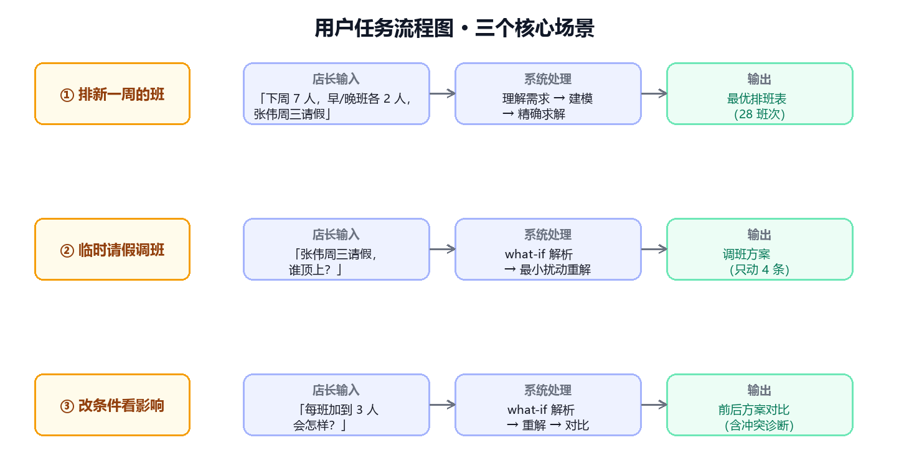

# 第 2 章　需求分析

> 主笔：郑茜文　·　初稿日期：2026-10-23
> 对应 `02-技术文档骨架.md` 第 2 章（2 页）。

---

## 2.1 用户角色与使用场景

**主角色：门店店长**——不懂运筹、不会建模，但懂业务、知道"谁哪天有事、谁该多休一天"。

**三个核心场景**：

|场景|店长想做什么|对应能力|
|-|-|-|
|① 排新一周的班|把下周需求说清楚，直接拿到一张可用的排班表|自然语言 → 建模 → 求解 → 排班表|
|② 临时有人请假要调班|"张伟周三请假，谁顶上？"|what-if 最小扰动调班|
|③ 想知道改一个条件会怎样|"如果每班加到 3 人会怎样？"|what-if 方案对比|

<i>图 2　用户任务流程图</i>

> 设计要点：**主角色只有一种人**——店长。不设"管理员/建模师"这种第二角色，是因为那样又回到了"传统排班软件要求用户会建模"的老路。整个产品只有一个入口：说一句话。

---

## 2.2 功能需求清单

**表 2　功能需求清单**

|编号|需求|优先级|实现状态|
|-|-|-|-|
|F1|自然语言输入并自动结构化为排班参数|必须|已实现|
|F2|求解并输出可视化排班表|必须|已实现|
|F3|约束冲突时定位冲突规则并给出建议|必须|已实现|
|F4|自然语言假设下的方案对比（what-if）|必须|已实现|
|F5|低置信度参数的人工确认|重要|部分实现|
|F6|评测集与量化指标|重要|待实现（10/24 完成）|
|F7|多模态输入（上传需求表截图）|可选|未实现|

> 说明：F1–F4 是"必须"，对应三个核心场景的闭环，已全部跑通；F5（人在环确认）已实现后端 `uncertainties` 字段、前端确认卡为部分完成；F6 评测集在 10/24 补齐；F7 多模态因工期取舍暂未实现。**诚实标注"未实现"不会扣分，虚报才会在答辩现场被问穿。**
