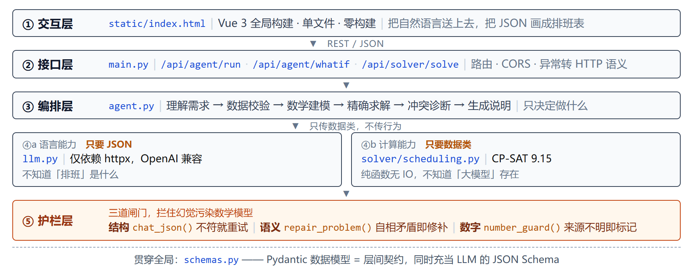

# 第 3 章　系统架构设计

## 3.1 分层架构

### 3.1.1 整体结构

系统分为五层，自上而下依次是交互层、接口层、编排层、能力层与护栏层（图 3）。

<i>图 3　系统分层架构图</i>

**分层真正落地的地方不是"每层负责什么"，而是"每层明确不做什么"**：交互层不做业务判断，
接口层不写业务逻辑，编排层不直接调模型 API，语言层不做计算，计算层不生成文案，护栏层不进正常路径的开销。
代码写歪，通常是某层悄悄干了下一层的活。

### 3.1.2 为什么这样分层

动机不是"看起来规范"，而是**三处真实的可替换性**。`llm.py` 全文只依赖 `httpx` 和 `pydantic`，
走 OpenAI 兼容协议，模型名与 `base_url` 全在 `.env` 里——换大模型不动 `solver/` 一行。
`solver/scheduling.py` 的入口是 `solve(problem: SchedulingProblem) -> SolveResult`，进出都是
`schemas.py` 里的纯数据类，内部无网络、无文件、无模型调用，能脱离整个项目单测
（`backend/demo_scheduling.py` 就是这么做的）——换求解器不影响交互。前后端之间只有 REST 契约——
换前端不影响后端，这也是我们敢在 15 天周期里用"单文件 + 零构建"前端的前提。

### 3.1.3 一条贯穿全局的边界：谁计算，谁说话

整个架构只有一条硬边界，其余都是它的推论：

> **所有数字由确定性代码产生，大模型只负责"把话翻译成结构"和"把结构翻译回话"。**

代码里能指出四处：`fact_numbers()` 先算出关键指标再喂给模型写说明；`_date_anchors()` 让
"本周/下周"的边界日期由 Python 算好、模型只准照抄（模型自己推日期会把"下周一"当成今天）；
`number_guard()` 把说明里白名单外的数字标记为可疑；what-if 的原方案 `baseline` 由后端重算，
不信任前端缓存。代价是"少一点灵活"，收益是**结果可验证、可复现、可审计**。

### 3.1.4 一次请求的完整数据流

以 7 人便利店场景为例，一次 `/api/agent/run` 的真实耗时分布：

| 阶段 | 层 | 耗时 | 占比 | 产出 |
| --- | --- | --- | --- | --- |
| S1 理解需求 | ③ → ④a | 4149 ms | 62.6% | `ExtractionResult`（含 `SchedulingProblem`） |
| S2 数据校验 | ③ | < 1 ms | — | 警告列表 |
| S3 数学建模 | ③ | < 1 ms | — | 决策变量约 98 个 |
| S4 精确求解 | ③ → ④b | **29 ms** | **0.44%** | `SolveResult`，28 条排班，OPTIMAL |
| S5 冲突诊断 | ③ | 0 ms | — | 约束可满足，无需松弛 |
| S6 生成决策说明 | ③ → ④a | 2362 ms | 35.7% | 中文决策说明 |
| **合计** | | **6625 ms** | 100% | |

**这张表是整章最重要的证据**：真正决定方案质量的计算只花 29 毫秒，**99.5% 的时间不花在求解上**——
两次语言转换占 98.3%，其余是步骤间开销。瓶颈在"理解"和"表达"而不在"求解"，优化方向也因此很清楚。

---

## 3.2 关键设计决策

### 表 3　三个关键设计决策

| 决策点 | 我们的选择 | 为什么 | 放弃了什么 |
| --- | --- | --- | --- |
| 编排方式 | **显式状态机**（六步固定） | 步骤确定、每步可校验、出错能定位到具体一步 | ReAct 的开放式探索能力 |
| 计算方式 | **CP-SAT 精确求解** | 结果可验证、同输入同输出、无解时能说出冲突 | "让模型直接生成方案"的简单做法 |
| 前端形态 | **Vue 3 单文件 + 内置运行时** | 零构建、离线可跑、评委 clone 下来直接开 | 工程化构建带来的模块化与生态 |

### 3.2.1 为什么是状态机而不是 ReAct

ReAct 让模型自己决定下一步调什么工具、调几次，适合**开放式探索任务**——路径无法预先确定。
而排班是**封闭式决策任务**：从一句话到一张排班表，必经步骤固定，不存在"要不要先查个天气"这种分支。
ReAct 在这里带来的是纯粹的成本：

1. **调用次数不可预测**。ReAct 每轮一次模型调用，6 步任务可能跑成 4 轮也可能 11 轮，耗时费用无法预估；
   状态机固定 2 次调用（S1、S6），端到端稳定在 6–7 秒。
2. **错误定位困难**。S4 挂了，一定是用例或建模的问题；ReAct 出错你只知道"某一轮推理偏了"。
3. **无法逐阶段评测**。状态机每步有独立的输入输出和耗时，可直接断言；ReAct 的中间态是自然语言推理，
   无法结构化校验。

代价是不能处理"一句话里含多个不相关诉求"的情况——排班场景里很少发生。

### 3.2.2 为什么是精确求解而不是让模型直接排

最省事的做法是把员工名单和规则丢给大模型直接出表。我们试过，三点不可接受：**约束满足不可验证**——
模型给的表看起来合理，但无法证明它满足"每人每周最多 5 天"，而 CP-SAT 的解带 `OPTIMAL` 状态、可逐条核对；
**同输入不同输出**——同一需求跑两次可能给出两张表，而排班是管理行为，店长要的是可复现的决策；
**无解时无法解释**——模型遇到排不出来通常给一个"差不多"的方案并声称可行，而 CP-SAT 会返回 `INFEASIBLE`，
并且能用删除法定位到**哪两条规则在打架**。

代价是必须把自然语言翻译成结构化模型，这一步本身会引入错误——所以才有第五层护栏。
**护栏是为这个决策付出的代价，也是它的配套。**

### 3.2.3 为什么前端不用构建工具

前端是 990 行的单文件，Vue 3 通过 `<script>` 直接引入仓库内的 `vendor/vue.global.prod.js`，
没有 `package.json`、没有 `node_modules`、没有构建产物。这不是"图省事"，而是针对**交付场景**的判断：
评委拿到仓库要能当场跑起来。一旦引入构建工具就多出三类失败可能——`npm install` 网络失败、
Node 版本不匹配、构建产物没提交。现在的前端"打开页面就能用"，由 FastAPI 的 `StaticFiles` 直接托管。
代价是样式、模板、逻辑全在一个文件里，这个代价在 15 天周期内可接受。

---

## 本章小结

**这个系统的架构，本质上是"把语言能力和计算能力分开"这一条判断的展开**：分层让两种能力各自可替换、
各自可测；状态机让"什么时候用语言、什么时候用计算"变成显式规则；精确求解让结果可验证；
三道护栏给"语言转结构"这一步兜底。第 4 章展开这条判断在 AI 技术层面的具体实现。
