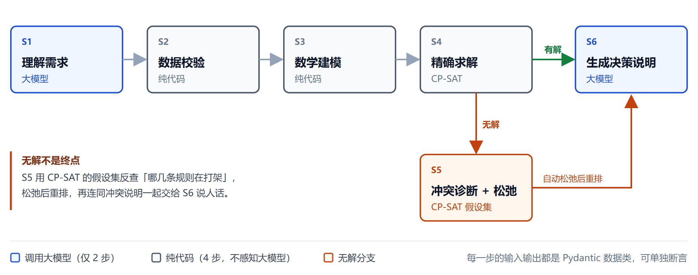
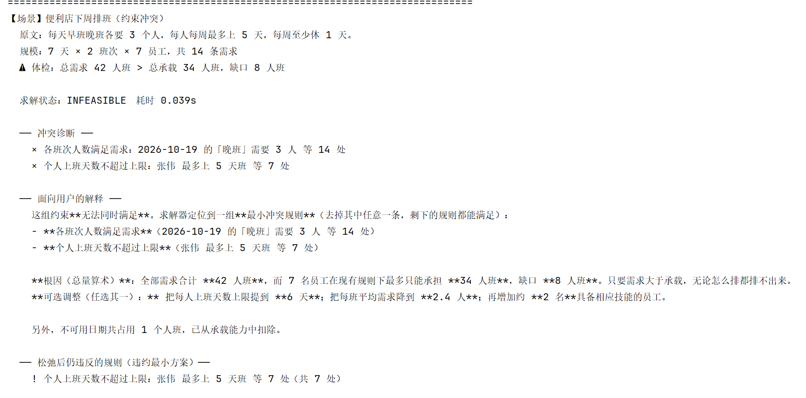

# 第 5 章　核心功能实现（建模与算法）

> 主笔：郑茜文　·　审校：冯璐　·　5.1/5.2 于 10/21，5.3/5.4 于 10/22 完成
> 对应 `02-技术文档骨架.md` 第 5 章（6 页）。
> 全部行号指向 `backend/app/solver/scheduling.py`（当前 771 行，含 10/19 的冗余约束版本）。

---

## 5.1 六步状态机

系统的完整链路是一个**六步显式状态机**（定义于 `agent.py`，其选型理由见第 4 章），如图 5。



<p align="center"><i>图 5　六步状态机流转图（只有 S1、S6 两步调用大模型）</i></p>

| 步 | 名称 | 干什么 | 是否调用大模型 |
|---|---|---|---|
| S1 | 理解需求 | 中文 → 结构化 `SchedulingProblem` | ✅ 是 |
| S2 | 数据校验 | 体检 + 修补自相矛盾 | ❌ 纯代码 |
| S3 | 数学建模 | 把参数建成 CP-SAT 模型 | ❌ 纯代码 |
| S4 | 精确求解 | CP-SAT 求最优 / 诊断 | ❌ 纯代码 |
| S5 | 冲突诊断 | 定位冲突规则 + 松弛 | ❌ 纯代码 |
| S6 | 生成决策说明 | 结果 → 中文建议 | ✅ 是 |

**本章聚焦 S3（数学建模）与 S4（精确求解）**——这两步正是 `scheduling.py` 的职责，也是"神经-符号"里"符号"那一半：**它不感知大模型的存在**，输入是纯数据类 `SchedulingProblem`，可脱离 LLM 单独测试（`demo_scheduling.py` 不联网就能跑）。

---

## 5.2 排班数学模型

### 5.2.1 决策变量

**主变量**（行 285–289）：

$$x_{e,d,s} \in \{0,1\},\quad e\in E,\ d\in D,\ s\in S$$

含义：员工 $e$ 在日期 $d$ 是否上班次 $s$。

**辅助变量**（行 291–296）：

$$w_{e,d} \in \{0,1\}$$

含义：员工 $e$ 在日期 $d$ 是否上班。它由主变量线性定义：

$$\sum_{s} x_{e,d,s} = w_{e,d}$$

（每人每天至多一个班，此式同时是"至多一班"的结构约束，永不放宽。）

**规模**：7 人 × 7 天 × 2 班次 = $98$ 个 $x$ 变量 + $49$ 个 $w$ 变量 = **147 个布尔变量**。

### 5.2.2 目标函数

$$\min \;\; \underbrace{20\sum_{e,d} w_{e,d}}_{\text{总人力成本}} \;+\; \underbrace{15\,\Delta_{\text{stab}}}_{\text{最小扰动}} \;+\; \underbrace{10\Big(\max_e L_e - \min_e L_e\Big)}_{\text{公平性}} \;+\; \underbrace{3\sum_{e,\ d\in P_e} w_{e,d}}_{\text{个人偏好}}$$

| 项 | 权重 | 行号 | 含义 |
|---|---|---|---|
| 总人力成本 $\sum w$ | 20 | 406–407 | 惩罚多排的班次 |
| 最小扰动 $\Delta_{\text{stab}}$ | 15 | 412–416 | 仅在 what-if 传入 baseline 时生效，$\Delta_{\text{stab}}$ = 与原方案不同的 $(e,d,s)$ 个数 |
| 公平性 $\max L_e - \min L_e$ | 10 | 418–425 | 最大与最小上班天数之差 |
| 个人偏好 $\sum_{d\in P_e} w$ | 3 | 427–430 | 尽量不在偏好休息日排班 |

### 5.2.3 约束

**两类物理约束（永不放宽）**：

1. **每人每天至多一班**（行 291–296）：$\displaystyle\sum_s x_{e,d,s} = w_{e,d}$
2. **技能匹配**（行 298–303）：若班次 $s$ 要求技能 $k$ 而员工 $e$ 不具备，则 $x_{e,d,s}=0$。物理上不可能违反，不属于业务取舍。

**五类业务规则（可诊断、可松弛，各挂一个"假设字面量"）**：

| # | 规则 | 数学形式 | 行号 |
|---|---|---|---|
| ① | 需求 | $\sum_e x_{e,d,s} \ge N_{d,s}$ | 305–322 |
| ② | 不可用 | $w_{e,d}=0,\ \forall d\in U_e$ | 337–348 |
| ③ | 天数上限 | $\sum_d w_{e,d} \le C_e$ | 350–365 |
| ④ | 休息天数 | 任意 7 天窗口 $W$：$\sum_{d\in W} w_{e,d} \le |W|-R$ | 367–384 |
| ⑤ | 连续工作 | 任意连续 $K+1$ 天窗口 $W$：$\sum_{d\in W} w_{e,d} \le K$ | 386–400 |

**一条冗余约束（纯加速，不改变可行域，行 324–335）**：

$$\sum_{e,d} w_{e,d} \;\ge\; \sum_{d,s} N_{d,s}$$

因为「每人每天至多一班」且「需求必须被满足」，上式必然成立——它是冗余的，但把目标函数的隐含信息变成了显式约束，极大加强了约束传播。实测 **5 人档（需求宽松）从 15 秒证不出最优 → 0.03 秒直接 OPTIMAL**，提速约两个数量级。（它必须挂 `demand` 闸门：诊断阶段会"删掉 demand 规则"试解，那时该下界不再成立，不挂闸门会误判不可行。）

### 5.2.4 符号表

| 符号 | 含义 |
|---|---|
| $E,\ D,\ S$ | 员工 / 日期 / 班次集合 |
| $x_{e,d,s}$ | 决策变量：员工 $e$ 在 $d$ 是否上班次 $s$ |
| $w_{e,d}$ | 辅助变量：员工 $e$ 在 $d$ 是否上班 |
| $L_e = \sum_d w_{e,d}$ | 员工 $e$ 的上班天数 |
| $N_{d,s}$ | 班次 $s$ 在日期 $d$ 的需求人数 |
| $C_e$ | 员工 $e$ 的上班天数上限 |
| $R$ | 每 7 天最少休息天数 |
| $K$ | 连续工作天数上限 |
| $U_e$ | 员工 $e$ 的不可用日期集合 |
| $P_e$ | 员工 $e$ 的偏好休息日集合 |

### 5.2.5 权重为什么是 20 > 15 > 10 > 3

这是**字典序优先级**的离散化，不是随手取值：

1. **20（总人力成本）必须最大**。因为需求约束是下界（$\ge$），不加这一项模型没有动力少排人——同一问题两次求解会给出 28 条 / 35 条、且都算"最优"（这就是 5.4 要讲的 Bug 1 的根）。
2. **15（最小扰动）次之**。业务上没人接受"一个人请假一天，整张表全重排"；但它只在 what-if 场景（传入 baseline）才有意义。
3. **10（公平）再其次**。公平是加分项，不是硬约束。
4. **3（偏好）最小**。休息偏好是"尽量满足"，可被牺牲。

四个权重拉开数量级，避免了多目标之间"权重纠缠、说不出谁更优先"的问题。

### 5.2.6 为什么每类规则一个「假设字面量」（5.3 的伏笔）

硬模式下，每类业务规则各创建一个布尔"假设字面量"（`gate(rule)`，行 274–280），对应约束用 `OnlyEnforceIf(gate)` 挂上，求解时统一交给 `AddAssumptions()`。

这样做的目的：**无解时能定位到"规则类别"（恒定 5 个），而不是几十条零散约束**——后者对业务人员毫无意义。这正是下一节"不可行自愈"能给出"这两条规则打架"而非"无解"二字的基础。

---

## 5.3 不可行自愈的两个难点 ★

### 5.3.1 机制：假设字面量 + 假设集

承接 5.2.6：硬模式求解时（`solve` 第一段，行 642–647），5 类规则各挂一个假设字面量，`AddAssumptions()` 一次性交给求解器。求解器返回 `INFEASIBLE` 后，调用 `SufficientAssumptionsForInfeasibility()` 拿到冲突集（行 671–677）。

但这一步有**两个坑**，直接照抄 OR-Tools 的返回结果是没法用的。

### 5.3.2 难点一：它返回的是「索引」，不是「下标」

`SufficientAssumptionsForInfeasibility()` 返回的是**字面量在模型中的索引**（`BoolVar.Index()`，形如 `147, 148, 149…`），**不是**假设列表的下标。

我们最初按"下标"去映射，结果全线对不上——打印出来是 147 起步的大数字，而假设总共只有 5 个。**必须先建反查表**（`_diagnose_conflicts`，行 521–551）：

```python
lit_index_to_rule = {}
for (rule, _detail), lit in zip(b.assumption_meta, b.assumptions):
    lit_index_to_rule[lit.Index()] = rule   # BoolVar.Index() → 规则名
```

再拿返回的索引去反查表里找对应的规则名。

### 5.3.3 难点二：它返回的是「充分集」，不是「最小集」

反查表建对了，拿到的东西依然没用：实测第一次跑，**5 类规则全部被返回**——"你 5 条规则都有问题"，对业务方等于没诊断。

**解法：删除法（delta-debugging）**（`_minimal_conflict_rules`，行 502–518）：

```
for 每条规则 r:
    如果去掉 r 之后仍然无解:
        真的去掉 r
剩下的就是最小冲突集
```

逐条试删：删掉某条后**仍无解**，说明它不是必需的，就真删；剩下的是真正互相打架的那 2 条。

**为什么搜索代价可接受**：假设粒度是"每类规则一个"，总量恒定为 5，最多 5 次求解，每次 < 0.1 秒。

### 5.3.4 总量算术：把「规则冲突」翻译成「人话」

纯规则级的"这两条冲突"还不够直白。`_explain`（行 571–618）配合 `capacity_analysis`，补了一段业务人员一定能看懂的因果：

> 全部需求合计 **42 人班**，而 7 名员工在现有规则下最多只能承担 **34 人班**，缺口 **8 人班**。只要需求大于承载，无论怎么排都排不出来。

并据此给出三条可执行的调整：把每人天数上限提到 6 天 / 把每班需求降到 2.4 人 / 再增加约 2 名员工。



---

## 5.4 最小扰动重排：两个先后发现的 bug

### 5.4.1 Bug 1：需求约束是下界，模型没动力少排人

**现象**：同一个问题两次求解，一次 28 条、一次 35 条，**都显示 OPTIMAL**。

**根因**：需求约束写的是 `covered >= need`（行 315–322），是下界不是等式。模型满足"至少 N 人"即可，没有动力少排人——"每人 4 天"和"每人 5 天"在目标函数里同样"最优"，求解器随性地多排。

**修法**：显式加总人力成本项（行 402–407）`sum(work) * 20`，让每多排一个班次都有代价。

### 5.4.2 Bug 2：修完之后，单点改动导致整表重排

**现象**：修完 Bug 1，总排班数稳定在 28。但 what-if 里"张伟少上一天"，整张表 **28 条几乎全变**——业务上不可接受：店长要的是"谁顶上这一班"，不是"换一张全新班表"。

**根因**：求解器只追求目标函数最优，没有"保持原方案"的动力。多个同样最优的解里，它随意挑一个，恰好和上一版完全不同。

**修法**：传入上一版方案作为 `baseline`，对"与原方案不同的 $(e,d,s)$"记惩罚分（行 409–416）：

```python
keep = {(a.employee_id, a.date, a.shift_id) for a in baseline}
for key, var in b.x.items():
    neg = var.Not() if key in keep else var   # 原方案有 → 惩罚"不排"；没有 → 惩罚"排"
    b.objective_terms.append(neg * COST_STABILITY)   # 15
```

**表 7　修复前后对比**：

| | 总排班数 | 改动条数 |
|---|---|---|
| 修复前 | 28 或 35（不确定） | 28 / 28 |
| 修复后 | 恒为 28 | **4 / 28** |

> 这两个 bug 是一对：Bug 1 是"多排了"，Bug 2 是"改多了"。它们共同证明一件事——**运筹模型的正确性不只在于"能出解"，更在于"出的解符合业务预期"**。目标函数每一项权重，背后都是一个踩过的坑。
