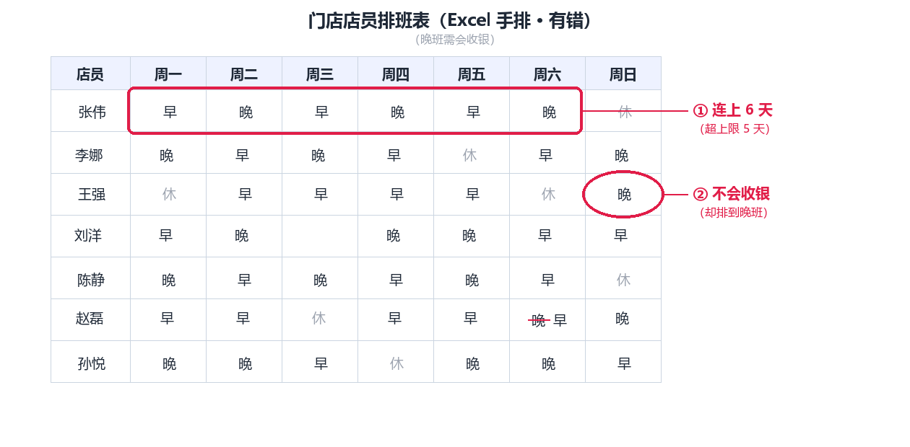
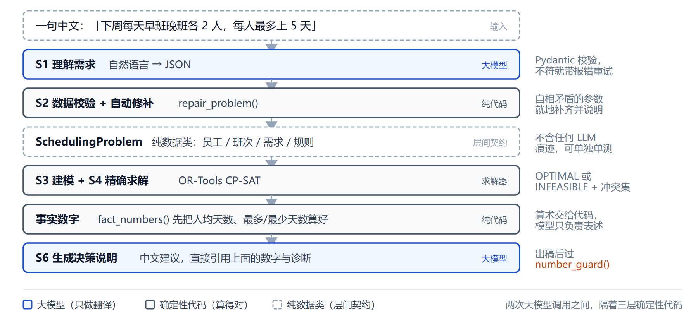

# 大模型驱动的智能运筹决策 Agent

> 技术文档 · 2026 传智杯 AI WEB 网页开发挑战赛

---

# 第 1 章　项目概述

> 主笔：郑茜文　·　初稿日期：2026-10-23
> 对应 `02-技术文档骨架.md` 第 1 章（3 页）。

---

## 1.1 排班问题的现实痛点

**一个具体场景**：某便利店有 7 名店员，每天分早班、晚班两个班次，晚班必须有人会收银。店长每周排一次班，每次都要同时考虑：谁哪天请假、谁会收银、每人最多上几天、每天每班要几个人。

**手工排班的成本**：店长用 Excel 一格一格填，我们模拟估算，**排一次约 2–4 小时**。

**手工排班的四类典型错误**（几乎每个排过班的人都踩过）：

1. **违反工时上限**——有人连上 6 天，超出规定；
2. **漏掉请假**——忘了某人周三请假，照样排了班；
3. **忙闲不均**——有人一周 6 天、有人只 3 天；
4. **技能不匹配**——把不会收银的人排到晚班。



<p align="center"><i>图 1　手工排班表（红圈标出两处错误）</i></p>

> 这一页的落点：这件事**又慢又容易错，但规则本身是确定的、可被计算的**——这正是"为什么值得用 AI 做"的理由。读完这页，一个不懂运筹的人应该能说出这句话。

---

## 1.2 现有方案的两条极端路线

市面上已有的做法卡在两个极端，中间是空的：

**表 1　现有方案对比**

|路线|代表|优点|致命缺陷|
|-|-|-|-|
|纯大模型直接排班|用 ChatGPT 描述需求|上手零门槛|**会算错**：漏需求、超工时，且无法验证|
|传统排班软件|各类 APS / 排班系统|算得对|**要求用户会建模语言**，业务人员学不会|

**这两条路之间的空隙，就是本项目的位置**：既要「说一句话就能用」（像大模型），又要「算得对、可验证」（像求解器）。前者解决"好不好用"，后者解决"对不对"——两者不可偏废。第 2 章把这个诉求落到具体需求，第 4 章展开技术上的取舍。

---

## 1.3 项目目标

**一句话目标**：用一句中文描述排班需求，得到一份**可验证的最优排班方案**。

**三个硬性指标**（达不到就不算完成）：

1. **精确或明确不可行**——结果必须是精确最优解，或者明确告知"这组约束无解"；
2. **不可行要说清原因**——无解时定位到哪几条规则冲突、给出该怎么改；
3. **可复现**——同一输入永远同一输出，不随运行次数变化。

> 这三条其实是"神经-符号"主张的具体化：第 1 条由求解器保证（精确求解），第 2 条由冲突诊断保证（见第 5 章），第 3 条由"大模型只做翻译、不做计算"的架构保证（见第 4 章）。

---

# 第 2 章　需求分析

> 主笔：郑茜文　·　初稿日期：2026-10-23
> 对应 `02-技术文档骨架.md` 第 2 章（2 页）。

---

## 2.1 用户角色与使用场景

**主角色：门店店长**——不懂运筹、不会建模，但懂业务、知道"谁哪天有事、谁该多休一天"。

**三个核心场景**：

|场景|店长想做什么|对应能力|
|-|-|-|
|① 排新一周的班|把下周需求说清楚，直接拿到一张可用的排班表|自然语言 → 建模 → 求解 → 排班表|
|② 临时有人请假要调班|"张伟周三请假，谁顶上？"|what-if 最小扰动调班|
|③ 想知道改一个条件会怎样|"如果每班加到 3 人会怎样？"|what-if 方案对比|


<p align="center"><i>图 2　用户任务流程图</i></p>

> 设计要点：**主角色只有一种人**——店长。不设"管理员/建模师"这种第二角色，是因为那样又回到了"传统排班软件要求用户会建模"的老路。整个产品只有一个入口：说一句话。

---

## 2.2 功能需求清单

**表 2　功能需求清单**

|编号|需求|优先级|实现状态|
|-|-|-|-|
|F1|自然语言输入并自动结构化为排班参数|必须|已实现|
|F2|求解并输出可视化排班表|必须|已实现|
|F3|约束冲突时定位冲突规则并给出建议|必须|已实现|
|F4|自然语言假设下的方案对比（what-if）|必须|已实现|
|F5|低置信度参数的人工确认|重要|部分实现|
|F6|评测集与量化指标|重要|待实现（10/24 完成）|
|F7|多模态输入（上传需求表截图）|可选|未实现|

> 说明：F1–F4 是"必须"，对应三个核心场景的闭环，已全部跑通；F5（人在环确认）已实现后端 `uncertainties` 字段、前端确认卡为部分完成；F6 评测集在 10/24 补齐；F7 多模态因工期取舍暂未实现。**诚实标注"未实现"不会扣分，虚报才会在答辩现场被问穿。**

---

# 第 3 章　系统架构设计

## 3.1 分层架构

### 3.1.1 整体结构

系统分为五层，自上而下依次是交互层、接口层、编排层、能力层与护栏层（图 3）。


<p align="center"><i>图 3　系统分层架构图</i></p>

**分层真正落地的地方不是"每层负责什么"，而是"每层明确不做什么"**：交互层不做业务判断，
接口层不写业务逻辑，编排层不直接调模型 API，语言层不做计算，计算层不生成文案，护栏层不进正常路径的开销。
代码写歪，通常是某层悄悄干了下一层的活。

### 3.1.2 为什么这样分层

动机不是"看起来规范"，而是**三处真实的可替换性**。`llm.py` 全文只依赖 `httpx` 和 `pydantic`，
走 OpenAI 兼容协议，模型名与 `base_url` 全在 `.env` 里——换大模型不动 `solver/` 一行。
`solver/scheduling.py` 的入口是 `solve(problem: SchedulingProblem) -> SolveResult`，进出都是
`schemas.py` 里的纯数据类，内部无网络、无文件、无模型调用，能脱离整个项目单测
（`backend/demo_scheduling.py` 就是这么做的）——换求解器不影响交互。前后端之间只有 REST 契约——
换前端不影响后端，这也是我们敢在 15 天周期里用"单文件 + 零构建"前端的前提。

### 3.1.3 一条贯穿全局的边界：谁计算，谁说话

整个架构只有一条硬边界，其余都是它的推论：

> **所有数字由确定性代码产生，大模型只负责"把话翻译成结构"和"把结构翻译回话"。**

代码里能指出四处：`fact_numbers()` 先算出关键指标再喂给模型写说明；`_date_anchors()` 让
"本周/下周"的边界日期由 Python 算好、模型只准照抄（模型自己推日期会把"下周一"当成今天）；
`number_guard()` 把说明里白名单外的数字标记为可疑；what-if 的原方案 `baseline` 由后端重算，
不信任前端缓存。代价是"少一点灵活"，收益是**结果可验证、可复现、可审计**。

### 3.1.4 一次请求的完整数据流

以 7 人便利店场景为例，一次 `/api/agent/run` 的真实耗时分布：

| 阶段 | 层 | 耗时 | 占比 | 产出 |
| --- | --- | --- | --- | --- |
| S1 理解需求 | ③ → ④a | 4149 ms | 62.6% | `ExtractionResult`（含 `SchedulingProblem`） |
| S2 数据校验 | ③ | < 1 ms | — | 警告列表 |
| S3 数学建模 | ③ | < 1 ms | — | 决策变量约 98 个 |
| S4 精确求解 | ③ → ④b | **29 ms** | **0.44%** | `SolveResult`，28 条排班，OPTIMAL |
| S5 冲突诊断 | ③ | 0 ms | — | 约束可满足，无需松弛 |
| S6 生成决策说明 | ③ → ④a | 2362 ms | 35.7% | 中文决策说明 |
| **合计** | | **6625 ms** | 100% | |

**这张表是整章最重要的证据**：真正决定方案质量的计算只花 29 毫秒，**99.5% 的时间不花在求解上**——
两次语言转换占 98.3%，其余是步骤间开销。瓶颈在"理解"和"表达"而不在"求解"，优化方向也因此很清楚。

---

## 3.2 关键设计决策

### 表 3　三个关键设计决策

| 决策点 | 我们的选择 | 为什么 | 放弃了什么 |
| --- | --- | --- | --- |
| 编排方式 | **显式状态机**（六步固定） | 步骤确定、每步可校验、出错能定位到具体一步 | ReAct 的开放式探索能力 |
| 计算方式 | **CP-SAT 精确求解** | 结果可验证、同输入同输出、无解时能说出冲突 | "让模型直接生成方案"的简单做法 |
| 前端形态 | **Vue 3 单文件 + 内置运行时** | 零构建、离线可跑、评委 clone 下来直接开 | 工程化构建带来的模块化与生态 |

### 3.2.1 为什么是状态机而不是 ReAct

ReAct 让模型自己决定下一步调什么工具、调几次，适合**开放式探索任务**——路径无法预先确定。
而排班是**封闭式决策任务**：从一句话到一张排班表，必经步骤固定，不存在"要不要先查个天气"这种分支。
ReAct 在这里带来的是纯粹的成本：

1. **调用次数不可预测**。ReAct 每轮一次模型调用，6 步任务可能跑成 4 轮也可能 11 轮，耗时费用无法预估；
   状态机固定 2 次调用（S1、S6），端到端稳定在 6–7 秒。
2. **错误定位困难**。S4 挂了，一定是用例或建模的问题；ReAct 出错你只知道"某一轮推理偏了"。
3. **无法逐阶段评测**。状态机每步有独立的输入输出和耗时，可直接断言；ReAct 的中间态是自然语言推理，
   无法结构化校验。

代价是不能处理"一句话里含多个不相关诉求"的情况——排班场景里很少发生。

### 3.2.2 为什么是精确求解而不是让模型直接排

最省事的做法是把员工名单和规则丢给大模型直接出表。我们试过，三点不可接受：**约束满足不可验证**——
模型给的表看起来合理，但无法证明它满足"每人每周最多 5 天"，而 CP-SAT 的解带 `OPTIMAL` 状态、可逐条核对；
**同输入不同输出**——同一需求跑两次可能给出两张表，而排班是管理行为，店长要的是可复现的决策；
**无解时无法解释**——模型遇到排不出来通常给一个"差不多"的方案并声称可行，而 CP-SAT 会返回 `INFEASIBLE`，
并且能用删除法定位到**哪两条规则在打架**。

代价是必须把自然语言翻译成结构化模型，这一步本身会引入错误——所以才有第五层护栏。
**护栏是为这个决策付出的代价，也是它的配套。**

### 3.2.3 为什么前端不用构建工具

前端是 990 行的单文件，Vue 3 通过 `<script>` 直接引入仓库内的 `vendor/vue.global.prod.js`，
没有 `package.json`、没有 `node_modules`、没有构建产物。这不是"图省事"，而是针对**交付场景**的判断：
评委拿到仓库要能当场跑起来。一旦引入构建工具就多出三类失败可能——`npm install` 网络失败、
Node 版本不匹配、构建产物没提交。现在的前端"打开页面就能用"，由 FastAPI 的 `StaticFiles` 直接托管。
代价是样式、模板、逻辑全在一个文件里，这个代价在 15 天周期内可接受。

---

## 本章小结

**这个系统的架构，本质上是"把语言能力和计算能力分开"这一条判断的展开**：分层让两种能力各自可替换、
各自可测；状态机让"什么时候用语言、什么时候用计算"变成显式规则；精确求解让结果可验证；
三道护栏给"语言转结构"这一步兜底。第 4 章展开这条判断在 AI 技术层面的具体实现。

---

# 第 4 章　AI 技术方案

> 主笔：冯璐　·　对应 `02-技术文档骨架.md` 第 4 章（6 页）。
> 官方要求「重点阐述 AI 技术的**选型理由、集成方式、优化策略**」，本章三节即按这三个词命名。

---

## 4.1 为什么必须用 AI，又不能只用 AI

这一节要立住一个矛盾：**输入是非结构化的中文，输出必须是可验证的精确解**。这两个要求各自把一类方案逼死。

**不用 AI 做不到，因为难点不在「排」，在「把一句话变成参数」。**
传统排班软件要求用户先填表：谁能上哪天、每班要几人、每人最多几天。这等于要求店长先学会运筹建模——他不会，于是他回去继续用 Excel。真正的门槛在语义：「张伟周三有事」要变成 `unavailable_dates`，「晚班得有人会收银」要变成班次的 `required_skill` 加员工的 `skills`，「别让人连上太多天」要变成 `max_consecutive_work_days`。这类映射用规则模板写不完，因为同一件事有无数种说法。

**只用 AI 也做不到，因为排班是管理行为，不是聊天。**
我们试过把员工名单和规则直接丢给大模型出表，三点不可接受：**结果不可验证**——模型给的表看着合理，但无法证明它满足「每人每周最多 5 天」，实测还会漏掉请假、把 28 个班次写成 35 个；**不可行时说不清原因**——排不出来时模型通常给一个「差不多」的方案并声称可行；**不可复现**——同一需求跑两次给两张表，而店长要的是一个能向上解释、能复盘的决定。

**表 4　三类方案的对比**

| 维度 | 纯传统软件 | 纯大模型 | 本项目 |
| --- | --- | --- | --- |
| 输入是自然语言 | ❌ 要用户先学会建模 | ✅ 擅长 | ✅ LLM 做语义解析 |
| 结果精确可验证 | ✅ | ❌ 会算错且无法证明 | ✅ CP-SAT 求解，带 `OPTIMAL` 状态 |
| 不可行时说清原因 | 部分支持 | ❌ 只会编一个可行方案 | ✅ 求解器返回冲突集 |
| 结果可复现 | ✅ | ❌ 每次不同 | ✅ 抽取温度 0.1 + 精确求解 |
| 开发成本 | 高（要建领域模型） | 低 | 中 |

于是分工只有一条：

> **AI 只负责「翻译」，不负责「计算」。**

这句话是全文的技术主张。第 3 章的五层分层、本章的四个选型、第 5 章的建模实现，都是它的推论；后面每一节都在为它提供证据。

---

## 4.2 选型理由

四个选型，每个都写「考虑过什么、为什么没选」。

### 4.2.1 为什么用 LLM，而不是规则模板或意图分类

- **规则模板**：「每人最多上 5 天」「不能连上超过 5 天」「一周干五休二」是同一件事的三种说法，再叠加「张伟周三有事」这类隐含信息，模板会指数级膨胀，且永远补不完。
- **意图分类模型**：只能识别「这是排班问题」，给一个标签；而我们需要的是能填进 98 个决策变量的完整参数。
- **LLM**：把任意中文说法映射到固定 schema，并且能处理隐含信息——「张伟周三有事」直接落到 `unavailable_dates: ["2026-10-21"]`，这是分类模型做不到的。

代价是模型会编。这个代价由 §4.4 的六项优化策略来还。

顺带回答一个常被问到的替代方案：**为什么不把排班规则放进向量库、让模型检索（RAG）？** 因为这里要的不是「相似」，是「精确」。RAG 擅长从大量非结构化文档里找回相关段落，而排班规则只有寥寥几条（每人最多几天、连上几天、某班要不要技能），它们需要的是**逐条落到字段上**，而不是被检索出来再让模型复述一遍。把五条规则塞进 Prompt 的成本，远低于搭一套检索链路；而检索失败会引入新的不确定性——这正是我们最不想要的东西。RAG 在「知识量大且模糊」的场景里划算，在「知识量小且精确」的场景里是负收益。

### 4.2.2 为什么是显式状态机，而不是 ReAct

ReAct 让模型自己决定下一步调什么工具、调几次，适合**路径无法预先确定**的开放式任务。排班是**封闭式决策任务**：从一句话到一张排班表，必经步骤固定，不存在「要不要先查个天气」这种分支。用 ReAct 在这里是纯成本：

1. **调用次数不可预测**。ReAct 每轮一次模型调用，六步任务可能跑成 4 轮也可能 11 轮，耗时和费用无法预估；状态机固定 2 次调用（S1、S6），端到端实测 6625 ms。
2. **错误定位困难**。S4 挂了，一定是用例或建模的问题；ReAct 出错你只知道「某一轮推理偏了」。
3. **无法逐阶段评测**。状态机每步有独立的输入、输出和耗时，可以直接断言；ReAct 的中间态是自然语言推理，没法结构化校验。

放弃的是「一句话里含多个不相关诉求」的处理能力——排班场景里很少发生。

**状态机的代价也要认。** 六步固定意味着扩展要改代码：如果哪天要加「先查历史排班再排」这一步，得在 `agent.py` 里加一个 `STEP_NAMES` 条目、一段执行逻辑、一份中间态的数据模型，而不是改两句 Prompt 就行。相比之下，ReAct 加一个工具只需注册进去，模型自己会决定何时调用。我们愿意付这个代价，是因为**排班流程的稳定性比它的可扩展性重要**——这个系统上线后不会每周长出新步骤，但每周都会被店长用一次，每次都不能出错。真到了步骤频繁变动的阶段，这套设计会成为负担，那时再换也不迟，因为第 3 章的分层保证了换编排方式不影响求解器。

### 4.2.3 为什么是 CP-SAT，而不是线性规划、启发式或让模型直排

| 方案 | 为什么不选 |
| --- | --- |
| 线性规划（LP） | 排班是 0/1 决策加逻辑约束（「要么…要么…」），LP 表达不了 |
| 启发式 / 遗传算法 | 只能给「较好的解」，无法证明最优，也给不出冲突集 |
| 让 LLM 直接排 | 会漏需求、超工时，且结果无法验证 |
| **CP-SAT** | 原生布尔变量与逻辑约束，能证明最优，**且支持假设集（assumptions）** |

最后一条是关键。CP-SAT 的 `SufficientAssumptionsForInfeasibility()` 能回答「哪几条规则同时成立才导致无解」，这是 LP 和启发式都没有的能力，也是第 5 章不可行自愈机制的地基。选 CP-SAT 不只是为了「算得快」，更是为了**排不出来的时候能说清为什么**。

### 4.2.4 为什么是 DeepSeek，而不是 GPT-4 或本地模型

- 中文语义理解够用，成本是学生队能承受的量级；
- 支持 `response_format: {"type": "json_object"}`，结构化输出稳定；
- 但真正的理由是**它被包在一个 OpenAI 兼容的适配层里**，换模型不动上层一行代码：

```python
class LLMClient:
    def __init__(self, api_key=None, base_url=None, model=None, timeout=90.0):
        self.base_url = (base_url or os.getenv("LLM_BASE_URL", DEFAULT_BASE_URL)).rstrip("/")
        self.model = model or os.getenv("LLM_MODEL", DEFAULT_MODEL)
```

`llm.py` 全文只依赖 `httpx` 和 `pydantic`，没有 import 任何厂商 SDK。换成 GPT-4 只需要改 `.env` 里的两个变量——这个判断的价值不在于「今天选了谁」，而在于**明天换人不付代价**。

**为什么不做微调。** 这是我们被问过最直接的一个问题，答案是不划算，理由有三条。其一，**数据量不够**：手头只有几十条真实排班需求，微调一个 7B 模型至少需要几千条标注样本，凑不够就是在过拟合几十个句式。其二，**微调解决的不是核心问题**：我们的失败模式里，「格式漂移」由 schema 校验兜住、「算错数字」由求解器和数字护栏兜住，这两类占绝大多数，而它们都不是「模型不懂排班」，而是「模型不该负责这件事」——微调改变不了这个分工。其三，**微调后仍然不能保证 100% 合规**：即使微调过，也必须在外面保留 Pydantic 校验，那微调带来的收益就只剩「少重试几次」，不足以抵消训练、评测、版本管理三份额外成本。所以结论是：把工程预算放在护栏上，而不是放在权重上。

**表 5　四个选型对比汇总**

| 选型 | 我们的选择 | 主要替代方案 | 决定性理由 |
| --- | --- | --- | --- |
| 语义解析 | LLM + 固定 schema | 规则模板 / 意图分类 | 说法无穷，模板补不完 |
| 编排方式 | 显式六步状态机 | ReAct 自主循环 | 步骤固定，不需要摸索；调用次数可控 |
| 计算方式 | CP-SAT 精确求解 | LP / 启发式 / 模型直排 | 能证明最优，**且能给冲突集** |
| 模型供应商 | DeepSeek（OpenAI 兼容层） | GPT-4 / 本地模型 | 换模型只改两个环境变量 |

---

## 4.3 集成方式

AI 不是「调个 API」，而是嵌在一条有明确边界的数据流里。一次完整请求经过七环，其中只有两环碰大模型：



<p align="center"><i>图 4　AI 数据流图：两次大模型调用之间隔着三层确定性代码</i></p>

### 4.3.1 接口隔离：求解器不知道有大模型

求解器的入口是 `solve(problem: SchedulingProblem) -> SolveResult`，进出都是 `schemas.py` 里的纯数据类，内部无网络、无文件、无模型调用。这不是设计洁癖，而是**可以被检验**的：

```python
@app.post("/api/solver/solve", response_model=SolveResponse)
def solver_solve(req: SolveRequest) -> SolveResponse:
    # 直接吃数据类，不经过 agent，不读 .env，不联网
    result = solve(req.problem, time_limit=req.time_limit)
    table = render_schedule_table(req.problem, result)
    return SolveResponse(result=result, schedule_table_md=table)
```

这个接口不经过 `DecisionAgent`、不读 `.env`、不联网，前端可以直接调。`backend/demo_scheduling.py` 同样能在断网的机器上跑出结果——**如果哪天大模型服务挂了，求解器仍然可用**，这是分层带来的实际收益，不只是纸面上的。

### 4.3.2 Schema 即契约：一份结构，三处使用

同一份数据结构在三个地方出现：Prompt 里的 JSON 骨架（给模型看）、`schemas.py` 的 Pydantic 模型（做校验）、接口的 `response_model`（给前端看）。

必须承认一个风险：**这三处是手写的，可能不同步**。我们的处理不是「相信它们一致」，而是让不一致在边界上暴露——`chat_json()` 拿到输出后立刻用 Pydantic 校验，不合格就带着报错重试：

```python
try:
    return schema_model.model_validate_json(content), content
except ValidationError as exc:
    if attempt >= max_retries:
        raise LLMError(f"JSON 不符合约定结构：{exc.errors()[:5]}")
    # 把模型自己的输出和具体报错一起回灌，让它照着改
    messages.append({"role": "assistant", "content": content})
    messages.append({"role": "user", "content": f"未通过校验，请重出：{exc.errors()[:5]}"})
```

脏数据在建模之前就被拦下，而不是变成一个难懂的求解器异常。

### 4.3.3 单向依赖：两层互不认识

LLM 层依赖 `schemas`，求解器层依赖 `schemas`，两层之间没有任何 import。这条可以一行命令验证：

```bash
grep -n "import" backend/app/solver/scheduling.py | grep -i llm   # 无输出
grep -n "import" backend/app/llm.py | grep -i solver              # 无输出
```

所以换模型不影响求解，改求解不影响提示词。这也是我们敢在 15 天周期里并行开发的原因——两个人改的代码在物理上不可能冲突。

### 4.3.4 三类失败分别在哪一环被拦下

集成方式好不好，不看正常路径跑得多漂亮，看**出错时能不能定位到具体一环**。这条链路上有三种典型失败，每一种都对应一个明确的拦截点：

**第一种，抽取错了。** 模型把「每人最多 5 天」理解成「每天最多 5 人」，或者漏了某个员工。这类错误在 S1 之后立刻暴露：Pydantic 校验能拦住格式问题，`validate_problem()` 能拦住语义问题（比如需求人数超过在岗人数），`repair_problem()` 能拦住自相矛盾。**共同点是：它们都发生在建模之前**，所以用户看到的是「参数可能有问题，请确认」，而不是一个莫名其妙的求解器异常。

**第二种，建模后无解。** 参数没错，但约束真的冲突了（42 人班的需求 vs 34 人班的承载）。这时 S4 返回 `INFEASIBLE`，S5 用 CP-SAT 的假设集反查冲突规则，给出「缺口 8 人班」和三条可执行调整。**这一类不是错误，是业务事实**，系统要做的是说清楚，而不是修好它。

**第三种，说明里编了数字。** 表排对了，但模型在写建议时把 28 个班次写成 35 个。`number_guard()` 在 S6 之后过一遍，把白名单外的数字标出来。这一环的特别之处在于：**它不阻止结果返回**，只做标记——因为方案本身是对的，不该因为一句话表述有瑕疵就让用户拿不到排班表。

三种失败、三个拦截点、三种处理方式（拦下 / 说清 / 标记），这就是「集成」在工程上的真实含义：不是把两个模块接起来就完了，而是**预先想好每一段接缝会怎么断**。

---

## 4.4 优化策略

官方要的「优化策略」，指的是**为了让 AI 输出可靠做了哪些工程手段**。六项，全部是代码里能指到行号的：

**表 6　六项优化策略**

| # | 策略 | 解决什么问题 | 落点 |
| --- | --- | --- | --- |
| 1 | 结构化输出 + 校验失败回灌重试 | 模型输出格式漂移 | `llm.py: chat_json()` |
| 2 | 抽取温度 0.1、说明温度 0.3 | 同输入结果不稳定 | `llm.py: chat_json / chat_text` |
| 3 | 语义自修补 | 抽出自相矛盾的参数 | `scheduling.py: repair_problem()` |
| 4 | 数字护栏 | 说明里编造数字 | `agent.py: number_guard()` |
| 5 | 事实数字由后端算好再喂 | 让模型自己算人均天数 | `agent.py: fact_numbers()` |
| 6 | 日期锚点由 Python 算好 | 模型把「下周一」当成今天 | `agent.py: _date_anchors()` |

几条值得单独说：

**第 3 条**是最「反常识」的一条。模型可能给某个班次标上「需要收银技能」，却没有任何员工被标为该技能——一上来就无解。`repair_problem()` 在这里做确定性修补：临时默认全员具备，并**大声说明**「请确认到底谁真的会收银」。从「必然无解」变成「能跑 + 提示确认」，比让用户对着一句无解发呆有用。

**第 4 条**是答辩现场的安全网。`number_guard()` 的规则极简单：说明里出现的每个数字，都必须能在事实材料里找到（外加 1–10 的白名单，因为「三条建议」这类序数词不算编造）。28 写成 35 这种错误肉眼很难发现，但被当场问住很致命。

**第 6 条**来自一次真实事故：当今天恰好是周一时，模型会把「下周一」理解成今天，整张表的日期全部前移一周。日期推算是确定性的整数运算，本来就不该让模型干——现在由 Python 算好边界日期，Prompt 里直接写「说下周一就用 2026-10-26，直接照抄，不要自己推算」。

这六项有个共同点：**它们都不指望模型变可靠，而是在模型不可靠的前提下让系统可靠**。这是「护栏」和「调参」的区别——调参是在赌概率，护栏是承认概率然后兜住。

**代价也要说清楚。** 这六项不是免费的，每一项都有成本，我们没有把它们藏起来：

- **第 1 条的重试会翻倍耗时**。校验失败要多调一次模型，端到端从 6.6 秒涨到 11 秒左右。所以 `max_retries` 设成 1 而不是 3——第二次仍失败说明 Prompt 或 schema 有问题，再重试只是拖时间。
- **第 3 条的修补可能掩盖配置错误**。给「要求收银技能但无人具备」的班次临时补齐全员技能，确实能让流程跑通，但如果店长本来就该标注谁不会收银，这个修补就把一个真实的数据错误变成了一个看起来正常的排班表。所以修补一定配一条醒目警告，且**记录在 `repairs` 字段里返回前端**，不允许静默修补。
- **第 4 条会误报**。白名单只放了 1–10 和事实材料里的数字，所以「三班倒」里的「三」如果写成阿拉伯数字就会被标记。我们接受这个误报率——漏报比误报危险得多。
- **第 2 条牺牲了表达多样性**。温度 0.1 让决策说明读起来偏模板化，不如温度 0.7 生动。对一个要交给店长看的说明来说，稳定比生动重要。

一句话总结取舍：**宁可多一次重试、多一条误报、少一点文采，也不要一个说不清为什么的排班结果。**

---

## 4.5 还没做好的三处

写到这里，有三处是我们明知不足、但这次没做完的，如实记下：

**第一，置信度目前只展示、不拦截。** 抽取阶段模型会为每个不确定字段给出 0–1 的置信度，前端以确认卡逐条列出百分比，但**没有按阈值自动阻断**——置信度 0.3 的字段和 0.9 的字段一样直接进入建模。正确的做法是低于阈值就停下来等店长确认，现在的实现是把判断权交给用户看，属于「人在环」的半成品。

**第二，`number_guard()` 的白名单是硬编码的。** 现在是「事实材料里的数字 + 1–10」，遇到「三班倒」这类表述会误报，遇到超过 10 的序数（「第十一条规则」）又可能漏报。可配置的白名单不难写，但需要先攒一批真实误报样本才能定阈值，现在样本还不够。

**第三，只支持一个班次模型。** 早班/晚班这种固定班次没问题，但「弹性上下班」「跨天夜班（22:00–06:00）」在当前的建模里表达不了——后者的日期归属本身就要额外定义。这是排班场景的常见需求，属于明确的能力边界，不是 bug。

把这三条写出来的原因很简单：**评委问「你们哪里做得不够」时，能给出具体位置的设计缺陷，比说「还在持续优化」可信得多。**

---

## 本章小结

**本章的主张可以压成一句：把「翻译」交给 AI，把「计算」交给求解器，然后在这条缝上装三道闸门。** 四个选型都在为这条边界服务——LLM 负责语义、状态机负责流程、CP-SAT 负责结果、适配层负责可替换；集成方式让这条边界可以被检验（一个不联网的求解器接口、一行 `grep` 就能证明）；优化策略则承认模型会犯错，并把每次犯错拦在污染数学模型之前。第 5 章展开这条边界在建模与算法上的具体实现。

---

# 第 5 章　核心功能实现（建模与算法）

> 主笔：郑茜文　·　审校：冯璐　·　5.1/5.2 于 10/21，5.3/5.4 于 10/22 完成
> 对应 `02-技术文档骨架.md` 第 5 章（6 页）。
> 全部行号指向 `backend/app/solver/scheduling.py`（当前 771 行，含 10/19 的冗余约束版本）。

---

## 5.1 六步状态机

系统的完整链路是一个**六步显式状态机**（定义于 `agent.py`，其选型理由见第 4 章），如图 5。


<p align="center"><i>图 5　六步状态机流转图（只有 S1、S6 两步调用大模型）</i></p>

| 步 | 名称 | 干什么 | 是否调用大模型 |
|---|---|---|---|
| S1 | 理解需求 | 中文 → 结构化 `SchedulingProblem` | ✅ 是 |
| S2 | 数据校验 | 体检 + 修补自相矛盾 | ❌ 纯代码 |
| S3 | 数学建模 | 把参数建成 CP-SAT 模型 | ❌ 纯代码 |
| S4 | 精确求解 | CP-SAT 求最优 / 诊断 | ❌ 纯代码 |
| S5 | 冲突诊断 | 定位冲突规则 + 松弛 | ❌ 纯代码 |
| S6 | 生成决策说明 | 结果 → 中文建议 | ✅ 是 |

**本章聚焦 S3（数学建模）与 S4（精确求解）**——这两步正是 `scheduling.py` 的职责，也是"神经-符号"里"符号"那一半：**它不感知大模型的存在**，输入是纯数据类 `SchedulingProblem`，可脱离 LLM 单独测试（`demo_scheduling.py` 不联网就能跑）。

---

## 5.2 排班数学模型

### 5.2.1 决策变量

**主变量**（行 285–289）：

$$x_{e,d,s} \in \{0,1\},\quad e\in E,\ d\in D,\ s\in S$$

含义：员工 $e$ 在日期 $d$ 是否上班次 $s$。

**辅助变量**（行 291–296）：

$$w_{e,d} \in \{0,1\}$$

含义：员工 $e$ 在日期 $d$ 是否上班。它由主变量线性定义：

$$\sum_{s} x_{e,d,s} = w_{e,d}$$

（每人每天至多一个班，此式同时是"至多一班"的结构约束，永不放宽。）

**规模**：7 人 × 7 天 × 2 班次 = $98$ 个 $x$ 变量 + $49$ 个 $w$ 变量 = **147 个布尔变量**。

### 5.2.2 目标函数

$$\min \;\; \underbrace{20\sum_{e,d} w_{e,d}}_{\text{总人力成本}} \;+\; \underbrace{15\,\Delta_{\text{stab}}}_{\text{最小扰动}} \;+\; \underbrace{10\Big(\max_e L_e - \min_e L_e\Big)}_{\text{公平性}} \;+\; \underbrace{3\sum_{e,\ d\in P_e} w_{e,d}}_{\text{个人偏好}}$$

| 项 | 权重 | 行号 | 含义 |
|---|---|---|---|
| 总人力成本 $\sum w$ | 20 | 406–407 | 惩罚多排的班次 |
| 最小扰动 $\Delta_{\text{stab}}$ | 15 | 412–416 | 仅在 what-if 传入 baseline 时生效，$\Delta_{\text{stab}}$ = 与原方案不同的 $(e,d,s)$ 个数 |
| 公平性 $\max L_e - \min L_e$ | 10 | 418–425 | 最大与最小上班天数之差 |
| 个人偏好 $\sum_{d\in P_e} w$ | 3 | 427–430 | 尽量不在偏好休息日排班 |

### 5.2.3 约束

**两类物理约束（永不放宽）**：

1. **每人每天至多一班**（行 291–296）：$\displaystyle\sum_s x_{e,d,s} = w_{e,d}$
2. **技能匹配**（行 298–303）：若班次 $s$ 要求技能 $k$ 而员工 $e$ 不具备，则 $x_{e,d,s}=0$。物理上不可能违反，不属于业务取舍。

**五类业务规则（可诊断、可松弛，各挂一个"假设字面量"）**：

| # | 规则 | 数学形式 | 行号 |
|---|---|---|---|
| ① | 需求 | $\sum_e x_{e,d,s} \ge N_{d,s}$ | 305–322 |
| ② | 不可用 | $w_{e,d}=0,\ \forall d\in U_e$ | 337–348 |
| ③ | 天数上限 | $\sum_d w_{e,d} \le C_e$ | 350–365 |
| ④ | 休息天数 | 任意 7 天窗口 $W$：$\sum_{d\in W} w_{e,d} \le |W|-R$ | 367–384 |
| ⑤ | 连续工作 | 任意连续 $K+1$ 天窗口 $W$：$\sum_{d\in W} w_{e,d} \le K$ | 386–400 |

**一条冗余约束（纯加速，不改变可行域，行 324–335）**：

$$\sum_{e,d} w_{e,d} \;\ge\; \sum_{d,s} N_{d,s}$$

因为「每人每天至多一班」且「需求必须被满足」，上式必然成立——它是冗余的，但把目标函数的隐含信息变成了显式约束，极大加强了约束传播。实测 **5 人档（需求宽松）从 15 秒证不出最优 → 0.03 秒直接 OPTIMAL**，提速约两个数量级。（它必须挂 `demand` 闸门：诊断阶段会"删掉 demand 规则"试解，那时该下界不再成立，不挂闸门会误判不可行。）

### 5.2.4 符号表

| 符号 | 含义 |
|---|---|
| $E,\ D,\ S$ | 员工 / 日期 / 班次集合 |
| $x_{e,d,s}$ | 决策变量：员工 $e$ 在 $d$ 是否上班次 $s$ |
| $w_{e,d}$ | 辅助变量：员工 $e$ 在 $d$ 是否上班 |
| $L_e = \sum_d w_{e,d}$ | 员工 $e$ 的上班天数 |
| $N_{d,s}$ | 班次 $s$ 在日期 $d$ 的需求人数 |
| $C_e$ | 员工 $e$ 的上班天数上限 |
| $R$ | 每 7 天最少休息天数 |
| $K$ | 连续工作天数上限 |
| $U_e$ | 员工 $e$ 的不可用日期集合 |
| $P_e$ | 员工 $e$ 的偏好休息日集合 |

### 5.2.5 权重为什么是 20 > 15 > 10 > 3

这是**字典序优先级**的离散化，不是随手取值：

1. **20（总人力成本）必须最大**。因为需求约束是下界（$\ge$），不加这一项模型没有动力少排人——同一问题两次求解会给出 28 条 / 35 条、且都算"最优"（这就是 5.4 要讲的 Bug 1 的根）。
2. **15（最小扰动）次之**。业务上没人接受"一个人请假一天，整张表全重排"；但它只在 what-if 场景（传入 baseline）才有意义。
3. **10（公平）再其次**。公平是加分项，不是硬约束。
4. **3（偏好）最小**。休息偏好是"尽量满足"，可被牺牲。

四个权重拉开数量级，避免了多目标之间"权重纠缠、说不出谁更优先"的问题。

### 5.2.6 为什么每类规则一个「假设字面量」（5.3 的伏笔）

硬模式下，每类业务规则各创建一个布尔"假设字面量"（`gate(rule)`，行 274–280），对应约束用 `OnlyEnforceIf(gate)` 挂上，求解时统一交给 `AddAssumptions()`。

这样做的目的：**无解时能定位到"规则类别"（恒定 5 个），而不是几十条零散约束**——后者对业务人员毫无意义。这正是下一节"不可行自愈"能给出"这两条规则打架"而非"无解"二字的基础。

---

## 5.3 不可行自愈的两个难点 ★

### 5.3.1 机制：假设字面量 + 假设集

承接 5.2.6：硬模式求解时（`solve` 第一段，行 642–647），5 类规则各挂一个假设字面量，`AddAssumptions()` 一次性交给求解器。求解器返回 `INFEASIBLE` 后，调用 `SufficientAssumptionsForInfeasibility()` 拿到冲突集（行 671–677）。

但这一步有**两个坑**，直接照抄 OR-Tools 的返回结果是没法用的。

### 5.3.2 难点一：它返回的是「索引」，不是「下标」

`SufficientAssumptionsForInfeasibility()` 返回的是**字面量在模型中的索引**（`BoolVar.Index()`，形如 `147, 148, 149…`），**不是**假设列表的下标。

我们最初按"下标"去映射，结果全线对不上——打印出来是 147 起步的大数字，而假设总共只有 5 个。**必须先建反查表**（`_diagnose_conflicts`，行 521–551）：

```python
lit_index_to_rule = {}
for (rule, _detail), lit in zip(b.assumption_meta, b.assumptions):
    lit_index_to_rule[lit.Index()] = rule   # BoolVar.Index() → 规则名
```

再拿返回的索引去反查表里找对应的规则名。

### 5.3.3 难点二：它返回的是「充分集」，不是「最小集」

反查表建对了，拿到的东西依然没用：实测第一次跑，**5 类规则全部被返回**——"你 5 条规则都有问题"，对业务方等于没诊断。

**解法：删除法（delta-debugging）**（`_minimal_conflict_rules`，行 502–518）：

```
for 每条规则 r:
    如果去掉 r 之后仍然无解:
        真的去掉 r
剩下的就是最小冲突集
```

逐条试删：删掉某条后**仍无解**，说明它不是必需的，就真删；剩下的是真正互相打架的那 2 条。

**为什么搜索代价可接受**：假设粒度是"每类规则一个"，总量恒定为 5，最多 5 次求解，每次 < 0.1 秒。

### 5.3.4 总量算术：把「规则冲突」翻译成「人话」

纯规则级的"这两条冲突"还不够直白。`_explain`（行 571–618）配合 `capacity_analysis`，补了一段业务人员一定能看懂的因果：

> 全部需求合计 **42 人班**，而 7 名员工在现有规则下最多只能承担 **34 人班**，缺口 **8 人班**。只要需求大于承载，无论怎么排都排不出来。

并据此给出三条可执行的调整：把每人天数上限提到 6 天 / 把每班需求降到 2.4 人 / 再增加约 2 名员工。


<p align="center"><i>图 6　不可行诊断的真实输出</i></p>

---

## 5.4 最小扰动重排：两个先后发现的 bug

### 5.4.1 Bug 1：需求约束是下界，模型没动力少排人

**现象**：同一个问题两次求解，一次 28 条、一次 35 条，**都显示 OPTIMAL**。

**根因**：需求约束写的是 `covered >= need`（行 315–322），是下界不是等式。模型满足"至少 N 人"即可，没有动力少排人——"每人 4 天"和"每人 5 天"在目标函数里同样"最优"，求解器随性地多排。

**修法**：显式加总人力成本项（行 402–407）`sum(work) * 20`，让每多排一个班次都有代价。

### 5.4.2 Bug 2：修完之后，单点改动导致整表重排

**现象**：修完 Bug 1，总排班数稳定在 28。但 what-if 里"张伟少上一天"，整张表 **28 条几乎全变**——业务上不可接受：店长要的是"谁顶上这一班"，不是"换一张全新班表"。

**根因**：求解器只追求目标函数最优，没有"保持原方案"的动力。多个同样最优的解里，它随意挑一个，恰好和上一版完全不同。

**修法**：传入上一版方案作为 `baseline`，对"与原方案不同的 $(e,d,s)$"记惩罚分（行 409–416）：

```python
keep = {(a.employee_id, a.date, a.shift_id) for a in baseline}
for key, var in b.x.items():
    neg = var.Not() if key in keep else var   # 原方案有 → 惩罚"不排"；没有 → 惩罚"排"
    b.objective_terms.append(neg * COST_STABILITY)   # 15
```

**表 7　修复前后对比**：

| | 总排班数 | 改动条数 |
|---|---|---|
| 修复前 | 28 或 35（不确定） | 28 / 28 |
| 修复后 | 恒为 28 | **4 / 28** |

> 这两个 bug 是一对：Bug 1 是"多排了"，Bug 2 是"改多了"。它们共同证明一件事——**运筹模型的正确性不只在于"能出解"，更在于"出的解符合业务预期"**。目标函数每一项权重，背后都是一个踩过的坑。

---

# 第 6 章　前端交互与可视化

> 主笔：郑茜文　·　初稿日期：2026-10-24　·　截图素材：李芳青
> 对应 `01-执行手册.md` 第 6 章（3 页）。

---

## 6.1 界面结构：左侧六区 + 右侧信息栏

前端是单文件 `backend/app/static/index.html`（Vue 3 全局构建，零打包，约 965 行），核心是**左侧主流程六区 + 右侧信息栏**：

| 区 | 标题 | 数据来源 | 作用 |
|---|---|---|---|
| ① | 用中文描述你的排班需求 | 本地输入（`text`） | 唯一入口 |
| ② | Agent 执行轨迹 | `run.steps[]` 的 `status/name/detail/duration_ms` | 六步状态可视化 |
| ③ | 决策建议 | `run.narrative` | 把结果翻译成人话 |
| ④ | 冲突诊断 | `run.result.conflicts` / `diagnosis` / `violations` | 无解时给原因 |
| ⑤ | 排班表 | `matrix`（由 `assignments` 重排成二维） | 一屏看整周 |
| ⑥ | 如果……会怎样？（方案对比） | `/api/agent/whatif` 的返回 | 方案对比 |

**图 7**：界面主截图


<p align="center"><i>图 7　界面主截图（六个区域见上表 ①–⑥）</i></p>

> 说明：截图用的是结果页（`ui-2-result.png`，已展示 ①–③、⑤、⑥）；冲突页见 `ui-3-conflict.png`（展示 ④）。若需「编号箭头」，在截图上用红圈 + 数字标出六区即可，编号对应上表。

**右侧信息栏**（一排指标卡，随运行结果填充）：

| 卡片 | 数据来源 | 作用 |
|---|---|---|
| 关键指标 | 员工数 / 天数 / 总排班 / 求解耗时 | 一眼看规模与性能 |
| 工时均衡度 | 最大上班天数 − 最小上班天数 | 公平性量化 |
| 需要你确认 | `run.extraction.uncertainties[]` | 低置信度字段的人机确认（HITL） |
| 自动修补与提醒 | `run.warnings[]` | 语义自修补的透明化 |
| Agent 的理解 | `run.extraction.summary` | 让用户核对理解对不对 |
| 工作原理 | 纯静态文案 | 一句话解释神经-符号 |

---

## 6.2 三个关键设计取舍

| 取舍 | 为什么 |
|---|---|
| **展示六步轨迹，而不是只给结果** | 让用户看见"系统怎么想的"，建立信任；也是防幻觉的透明化——每一步的输入输出都能对照 |
| **冲突用卡片 + 红黄分级，不用弹窗** | 弹窗会被直接关掉，卡片可以对照着看；红＝硬冲突、黄＝需要确认 |
| **排班表用颜色区分班次** | 一屏看懂整周，比读表格快得多 |

另有两个补充取舍：

- **单文件 + 全局构建（零打包）**：拿到仓库就能跑，不依赖 `npm install` / Node 版本；代价是 965 行都堆在一个文件里。
- **what-if 用「黄框高亮差异」而不是并排两张表**：改动的格子直接标黄，一眼看出扰动大小（与第 5 章「最小扰动 4/28」呼应）。

---

## 6.3 关键交互：一次提交 → 六步轨迹 → 冲突卡 → what-if

1. **点【开始排班】**：① 输入 → `POST /api/agent/run` → ② 轨迹逐条点亮（`running → ok/warn/error`）→ ③ 决策建议 → ⑤ 排班表 → 右侧指标卡填充。
2. **无解时**：④ 冲突诊断卡出现，给出最小冲突规则 + 总量算术 + 三条调整建议；下方同时给「违约最小」的近似方案。
3. **what-if**：⑥ 输入「如果张伟周三请假会怎样」→ 重解 → 黄框标出变动格 + 指标卡对比（总排班数 / 改动条数 / 保持不动）。

---

## 6.4 移动端

窄屏自动切成单栏，7 列排班表可横向滑动，不崩（见 `ui-4-mobile.png`）。

---

# 第 7 章　测试与部署

> 主笔：郑茜文　·　初稿日期：2026-10-24　·　benchmark 指标由冯璐提供
> 对应 `01-执行手册.md` 第 7 章（2 页）。

---

## 7.1 评测集设计

**表 8　30 题分布**

| 类型 | 数量 | 设计意图 |
|---|---|---|
| 常规场景 | 18 | 不同规模、不同班次数 |
| 边界场景 | 6 | 单人、满负荷、整天不可用 |
| 冲突场景 | 6 | 检验自愈能力 |

评测集分两个文件：`backend/benchmark/cases.json` 存 30 道题，`backend/benchmark/run_cases.py` 负责跑分。

**每题 = 一段自然语言描述 + 一份完整的问题规格**（不是排班表）。排班表由求解器确定性算出，比对它没有意义；模型这一环真正的变量是「张伟周三请假」有没有被抽成不可用日期。因此标准答案就是「这道题应该被抽成什么样」，逐字段比对 10 项：员工人数、姓名集合、逐人技能、班次数、每班起止、每班技能要求、日期列表、每日每班需求、四项规则、请假日期。

**标准答案先自证，再拿来考模型。** `run_cases.py --validate` 会把标准答案直接喂给求解器：常规与边界题必须求出 OPTIMAL、冲突题必须报出设计的根因规则。这一步不调模型、不花钱，能在几秒内把「答案本身写错」全部挤出来——否则跑分时分不清是模型答错还是答案写错。

题面里的日期一律写成「下周」，绝对日期由 `agent._date_anchors()` 在运行时解析。写死日期会让题库隔天失效。

---

## 7.2 量化指标

**表 9　实测结果**（`run_cases.py`，2026-10-24，deepseek-chat，30 题）

| 指标 | 定义 | 结果 |
|---|---|---|
| JSON 一次通过率 | 抽取阶段一次返回合法 JSON / 30 题 | **30 / 30 = 100%** |
| 参数抽取准确率 | 逐字段比对通过数 / 300 个字段 | **298 / 300 = 99.3%** |
| 建模成功率 | 常规+边界题求出 OPTIMAL / 24 题 | **24 / 24 = 100%** |
| 冲突诊断命中率 | 设计根因被报出 / 6 道冲突题 | **6 / 6 = 100%** |
| 冲突诊断精确率 | 除 demand 外，报出的规则与设计根因完全一致 | **4 / 6 = 67%** |
| 数字幻觉检出 | 数字护栏判定「来源不明」的数字 / 触发题数 | **0 个 / 0 题** |
| 端到端平均耗时 | 单题从提交到出结果 | **6.5 s** |

**两处错在哪儿，值得说清。** 300 个字段只错了 2 个，都在 `rules` 上：题面说「每人每周至少休息 3 天」，模型除了正确抽出休息天数，还**自作主张**把「最多上 5 天」改成了 4 天——它替我们把休息天数换算成了上班天数。这个推断本身没错，题面也确实隐含这层意思，但 Prompt 第 5 条明确要求「用户没提的规则用默认值，不要自己加严」。**这类「过度解读」是收紧约束的主要来源，而收紧约束正是不可行的主要来源**，所以计入错误。

**冲突诊断精确率只有 67%，是因为多报的两条是真问题。** C04（上限降到 3 天）和 C05（每周休 5 天）除了报出设计根因，还多报了一条「技能不匹配」——因为上限一降，会收银的 3 个人也凑不出晚班需要的 14 个班。这不是误报，是同一处收紧引发的第二个瓶颈。

**数字护栏 30 题一次没触发，不代表它没用。** 我们做了注入实验：把「28 个班次」改成「35 个班次」，护栏立刻返回 `['35']`；模型自行算出的「平均每人 4.0 天」也被拦下（`['4.0']`）。0 次触发说明这 30 题的决策说明里确实没出现来源不明的数字。

**表 9-a　三档规模求解性能（真实数据，每档 5 次）**

| 规模 | 决策变量 | 需求班次 | 状态 | 中位数 | P90 | 目标值 |
|---|---|---|---|---|---|---|
| 5 人（每班 1 人） | 70 | 14 | OPTIMAL | **78 ms** | 85 ms | 290 |
| 7 人（每班 2 人） | 98 | 28 | OPTIMAL | **13 ms** | 16 ms | 560 |
| 12 人（每班 3 人） | 168 | 42 | OPTIMAL | **149 ms** | 157 ms | 850 |

> 三档全部求到 **OPTIMAL**（不是"找到可行解就停"），这是"精确求解"的证据。
> 注意 **5 人档（78 ms）比 7 人档（13 ms）慢**——不是笔误：5 人档每班只需 1 人、需求宽松，可行域大得多，求解器要花更多时间**证明**已最优；7 人档需求紧、可行域小，反而更快。**影响耗时的是需求紧度，不是人数。**

---

## 7.3 与纯大模型方案的对比

**表 10　同一道题：我们的系统 vs 纯大模型直接生成**

| 维度 | 我们的系统 | 纯大模型直接排 |
|---|---|---|
| 满足全部约束 | ✅ 求解器保证 | ❌ 常漏需求、超工时 |
| 总班次数 = 需求 | ✅ 28 = 28 | ❌ 28 写成 35（真实发生过） |
| 可复现 | ✅ 同输入同输出 | ❌ 每次不同 |
| 不可行诊断 | ✅ 最小冲突集 + 调整建议 | ❌ 只会说"排不出来" |
| 求解耗时 | 13 ms（确定性） | 秒级（生成），且不可验证 |

---

## 7.4 部署与运行

**环境变量**（对照 `backend/.env.example`）：

| 变量 | 作用 |
|---|---|
| `DEEPSEEK_API_KEY` | DeepSeek 密钥，**不提交**，只放本地 `.env` |
| `LLM_BASE_URL` | 可选，换模型只改这里 |
| `LLM_MODEL` | 可选，默认 `deepseek-chat` |
| `LLM_MOCK` | 设为 1 时进入离线样例模式，不调用 API |

**依赖**（`requirements.txt`，实测版本）：

| 包 | 版本 |
|---|---|
| ortools | ≥ 9.10 |
| fastapi | ≥ 0.110 |
| uvicorn | ≥ 0.27 |
| httpx | ≥ 0.27 |
| pydantic | ≥ 2.6 |
| python-dotenv | ≥ 1.0 |

**从零到跑起来（5 步）**：

```
① git clone https://github.com/bjun3547-jpg/aiweb-decision-agent.git
② python -m venv .venv
③ .venv\Scripts\python.exe -m pip install -r backend\requirements.txt
④ 复制 backend\.env.example → backend\.env，填 DEEPSEEK_API_KEY
⑤ cd backend && ..\.venv\Scripts\python.exe -m uvicorn app.main:app --port 8000
```

打开 <http://127.0.0.1:8000> 即可使用；API 文档在 `/docs`。

**常见问题**：

| 现象 | 原因 | 解决 |
|---|---|---|
| `git push` 报 TLS / `unexpected eof` | 国内网络对 GitHub 的干扰 | 配代理：`git config --global http.proxy http://127.0.0.1:7897`（换成自己的端口） |
| 界面提示「大模型未配置」 | 没有 `.env` 或 Key 为空 | 配 `.env`，或设 `LLM_MOCK=1` 用离线样例 |
| 端口 8000 被占用 | 已有进程 | 换 `--port 8001` |
| `demo_scheduling.py` 打印 ⚠ 报 GBK 错 | Windows 控制台编码 | 先设 `$env:PYTHONUTF8='1'` |

---

# 第 8 章　创新点说明

> 主笔：郑茜文　·　初稿日期：2026-10-26
> 对应 `02-技术文档骨架.md` 第 8 章（2 页）★★ 官方点名重点
> 官方要求：须明确列出**技术创新点**与**应用创新点**两类。

本章不空谈「我们很创新」，用**对比表和实测数字**说话。创新分两层：**技术创新点**回答「系统内部怎么做的」，**应用创新点**回答「对用户意味着什么」。

---

## 8.1 技术创新点

### T1　神经-符号混合架构

**解决什么问题**：排班的输入是自然语言，输出必须精确可验证。纯大模型直接排会算错（实测把 28 个班次写成 35 个、漏掉请假），且无法验证；纯求解器又「不会听人话」——传统排班软件要求用户先学会建模，店长学不会。

**怎么做**：让大模型只负责「翻译」（S1 把中文抽成结构化参数、S6 把结果翻译回中文），让 CP-SAT 负责「计算」，中间用 Pydantic Schema 卡死、两层互不 import——换模型不影响求解，改求解不影响提示词。

**效果数据**：端到端 6.5 秒里，精确求解只占 **29 ms（0.44%）**；同输入同输出；30 题评测建模成功率 **24/24**。

### T2　类别级假设字面量 + 删除法最小冲突集

**解决什么问题**：约束无解时，求解器只报一句「无解」，对业务方毫无信息量。

**怎么做**：每类业务规则各挂一个「假设字面量」（恒 5 个），用 `SufficientAssumptionsForInfeasibility()` 拿冲突集；但它返回的是「充分集」（往往 5 类全给），再用**删除法**逐条试删，把充分集收敛成「最小集」。

**效果数据**：从「无解」变成「这 2 条规则打架，改任一条即可」，并给出总量算术（**42 人班 vs 34 人班，缺口 8**）；冲突诊断命中率 **6/6**。

### T3　最小扰动重排

**解决什么问题**：改一个条件，整张班表全部重排，业务上没人接受——店长要的是「谁顶上这一班」，不是「换一张全新班表」。

**怎么做**：what-if 重解时把上一版方案作为 baseline 传入，对「与原方案不同的（员工, 日期, 班次）」记惩罚分（权重 15，仅次于总人力成本的 20）。

**效果数据**：让张伟从 4 天减到 2 天，**只改动 4 / 28 条**，其余 26 条原封不动。

**表 11　技术创新点汇总**

| # | 创新点 | 解决了什么 | 怎么做 | 效果 |
| --- | --- | --- | --- | --- |
| T1 | 神经-符号混合架构 | 纯 LLM 算不准、纯求解器不会听人话 | LLM 只做翻译，CP-SAT 做计算，Schema 卡死 | 求解占 0.44%，同输入同输出 |
| T2 | 类别级假设字面量 + 删除法 | 求解器报「无解」没信息量 | 每类规则一个假设；删除法收敛最小集 | 「这 2 条规则打架」，命中 6/6 |
| T3 | 最小扰动重排 | 改一个条件全表重排，不可接受 | 传 baseline，对差异记惩罚分 | 改 1 个条件只动 4/28 条 |

---

## 8.2 应用创新点

### A1　把「无解」变成可执行的调整建议

传统做法弹一句「约束冲突，无法排班」，店长既看不懂也帮不上忙。我们把冲突定位到规则、补上总量算术，并给出三条可选调整——**店长知道该改哪个数字**，而不是对着「无解」发呆。

### A2　用中文做 what-if

传统上「改一个条件看看」要重新建模、重新跑。这里直接说「如果张伟周三请假会怎样」，系统解析成结构化变更、自动重解、并排对比——**决策成本从小时级降到秒级**，这正是「决策 Agent」里「决策」二字的落点。

### A3　决策说明里的数字可核查

AI 写的建议里数字无法验证，没人敢拿去给老板看。数字护栏要求每个数字都能在事实材料里找到（实测注入「35 个班次」立刻被拦下）——**用户敢把结果往上交**。

**表 12　应用创新点汇总**

| # | 应用创新点 | 传统做法 | 我们的做法 | 用户收益 |
| --- | --- | --- | --- | --- |
| A1 | 把「无解」变成可执行建议 | 弹「约束冲突，无法排班」 | 定位冲突规则 + 总量算术 + 三条调整 | 店长知道该改哪个数字 |
| A2 | 用中文做 what-if | 改参数要重新建模、重新跑 | 一句假设 → 自动重解 + 并排对比 | 决策成本小时级 → 秒级 |
| A3 | 决策说明数字可核查 | AI 说的数字无法验证 | 数字护栏：每个数字必须在事实材料中 | 敢把结果给老板看 |

---

# 第 9 章　总结与展望

> 主笔：郑茜文　·　初稿日期：2026-10-26
> 对应 `02-技术文档骨架.md` 第 9 章（2 页）。

---

## 9.1 诚实的局限

这一节如实写局限——写得好会加分，写得虚会扣分。当前系统的能力边界有五处：

1. **只支持排班一类问题**：未覆盖带时间窗的车辆路径（VRPTW）、生产排产等其它运筹问题。这是 15 天周期内的刻意收敛（「一个主场景做深」），但确实是边界，不是「已覆盖全部运筹」。
2. **多模态入口未实现**：官方考核点里点名的「多模态」（上传需求表截图 / Excel 自动抽取）未做，输入只有自然语言一条路。
3. **评测集规模 30 题，样本偏小**：能给出量化指标（建模成功率、冲突命中率），但统计上还谈不上充分。
4. **依赖单一大模型（DeepSeek）**：虽封装了可替换适配层（换模型只改两个环境变量），但未做多模型横向对比，选型依据是实测而非系统评测。
5. **冲突诊断的粒度是「规则类别」**：能定位到「这两类规则打架」，但还到不了「具体哪一条约束」。

> 另有第 4 章 4.5 如实记录的三处设计缺陷：置信度只展示不拦截（人在环是半成品）、`number_guard` 白名单硬编码、只支持固定班次模型（表达不了跨天夜班）。它们与上面五条共同构成一份完整、诚实的边界清单。

---

## 9.2 展望

1. **扩展到第二类运筹问题**：带时间窗的车辆路径（VRPTW），复用同一套「LLM 翻译 + CP-SAT 求解」框架，验证框架的可迁移性。
2. **敏感性分析**：用求解器的对偶值 / 影子价格翻译成「多 1 小时工时值多少钱」，把「最优解」升级成「决策建议」。
3. **真实数据回测**：引入企业历史排班数据，验证在真实约束密度下的表现。
4. **多模型对比评测**：量化选型依据，而不是「我们觉得 DeepSeek 好」。

---

# 第 10 章　团队分工与开发过程

> 主笔：郑茜文　·　初稿日期：2026-10-26
> 对应 `02-技术文档骨架.md` 第 10 章（1 页）。

---

## 10.1 团队分工

**表 13　团队分工**

| 成员 | 负责模块 | 提交数 | 主要贡献 |
| --- | --- | --- | --- |
| 冯璐 | Agent 编排、求解器、部署 | 67 | 六步状态机、LLM 适配层、CP-SAT 建模与冲突诊断、公网部署、benchmark 跑分器 |
| 李芳青 | 前端与可视化、演示视频 | 8 | 界面、排班矩阵、工时热力图、演示视频 |
| 郑茜文 | 技术文档、评测集、建模验证 | 12 | 第 1 / 2 / 5 / 6 / 7 / 8 / 9 / 10 章、30 题评测集、求解器验证 |

> 提交数由 `git shortlog -sn` 统计（截至 10/26）。郑茜文的 12 条 = 11 条署名「郑茜文」+ 1 条署名「qiqi77317」（10/17 验证 push 连通性，两套 git 身份、同一邮箱）。

---

## 10.2 开发过程

**周期**：15 天（10/17 搭原型 → 11/01 提交），提交跨越 10 天、共 87 条，三人都有记录。

**协作方式**：3 人 3 条线并行（后端 / 前端 / 文档），分工到文件、不碰别人文件、每天 commit——这是能在 15 天内并行不冲突的前提。

**最关键的两次返工**：

1. **需求约束是下界导致多排（Bug 1）+ 修完单点改动全表重排（Bug 2）**：同一问题两次求解给出 28 条 / 35 条、且都「最优」，修完又发现「一个人请假整表全变」。最终加「总人力成本」和「最小扰动」两个目标项，改 1 个条件只动 4/28 条。
2. **接真模型暴露的三个幻觉**：技能无人具备、把 28 写成 35、模型自算人均。没有走「改 Prompt 求它别犯错」的路，而是加三道确定性护栏（结构 / 语义 / 数字）——凡是能算出确定答案的，就不让模型算。
